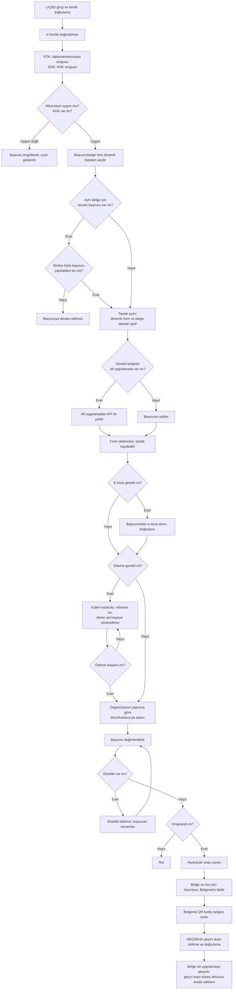

# Aşama 1 — Mevcut Durum Analizi

Bu doküman üç şeyi inceler: (1) repodaki CSB framework şablonu, (2) `Belge_Matrisi_MEÇEP.xlsx`, (3) süreç
diyagramları ve kapsam analizi dokümanı. Framework hakkındaki her iddia kod okunarak doğrulandı; dosya yolları repo
köküne göredir. Doğrulanamayan veya kaynaklarda boş bırakılan her şey [acik-sorular.md](acik-sorular.md) içindedir.

İncelenen kaynaklar (`D:\MEÇEB`):

| Kaynak | İçerik |
| --- | --- |
| `Belge_Matrisi_MEÇEP.xlsx` | "Belge Matrisi" (19 satır, 14 sütun) ve "Kaynak Hücreler" (diyagramdan dökülmüş 65 hücre) sayfaları |
| `genel.png`, `Flowcharts - GENEL (1).pdf` | "MEÇEB – Başvuru ve Onay Süreci" kulvarlı akış diyagramı (aynı diyagramın iki biçimi) |
| `sistem yöneticisi.png` | Sistem yöneticisi işlem akışı |
| `MERKEZİ ÇEVRE BELGELENDİR KAPSAM ANALİZİ_09112026.docx` | Kapsam analiz raporu (istekte anılmıyordu, klasörde bulundu; analizde kullanıldı) |

---

## 1. Framework envanteri

### 1.1 Özet

Repo, ASP.NET Boilerplate / Zero türevi **CSB 11.0.0** paketleri üzerine kurulu bir **şablon projedir**; proje adı hâlâ
`CSB.ProjectName`, kökte `rename.ps1` var. Klasik ABP n-katmanlı yapı kullanır. İş mantığı olarak yalnızca örnek
Customer / Product / Order modülleri bulunur. MEÇEB'in ihtiyaç duyduğu yeteneklerin büyük kısmı (iş akışı, dinamik
form, dosya saklama, arka plan işi, bildirim, birim bazlı yetki) **bugün yoktur**; bir kısmı için paket yerel feed'de
durur ama hiçbir projeye bağlı değildir.

> **README ile kod uyuşmuyor.** `README.md` ve `backend/README.md` .NET 10, FluentValidation, `__csb` yanıt zarfı,
> entity-history seçicileri, yorum satırındaki Hangfire, 2FA ve RefreshToken'dan söz eder. Kodda hiçbiri yoktur. Bu
> dokümanda yalnızca kodda doğrulanan durum esas alınmıştır.

### 1.2 İstenen başlıklara göre durum

| # | Konu | Durum | Dayanak |
| --- | --- | --- | --- |
| 1 | .NET sürümü | **.NET 9** (`net9.0`), tüm 9 proje. Web.Core/Web.Host `LangVersion 7.2` | `backend/src/*/*.csproj` |
| 2 | Framework | CSB `11.0.0` paketleri (ABP Zero türevi). Framework kaynağı bu repoda değil | `nuget-packages/`, `backend/NuGet.Config` |
| 3 | Backend mimarisi | Klasik ABP n-katman + modül sınıfları; AppService'ler dinamik API controller olarak yayınlanır (`/api/services/app/...`, `/api/services/sys/...`) | `Web.Core/ProjectNameWebCoreModule.cs:56-65` |
| 4 | Frontend | Angular 21.2, standalone bileşenler, Angular Material 21.2, Tailwind 3, Transloco, Fuse kabuğu, `@csb/*` bileşen paketleri | `frontend/package.json` |
| 5 | Katmanlar | Domain (entity), Core (yetki, kimlik, yapılandırma), System (sistem servisleri), Application (iş servisleri), EntityFrameworkCore, Web.Core, Web.Host, Migrator | `backend/src/` |
| 6 | Onion / Clean Architecture | **Yok.** Domain projesi modül içermeyen düz entity kütüphanesi; Core, Domain'e referans vermez; repository arayüzleri framework'ten gelir | csproj referansları |
| 7 | CQRS / MediatR | **Yok** (kod ve csproj'larda eşleşme yok) | — |
| 8 | Repository + Unit of Work | Var. `IRepository<T, Guid>` otomatik kaydedilir; tek özel taban `ProjectNameRepositoryBase` (`GridQueryBuilder`'a yönlendirir). UoW framework kuralıyla; servisler `CurrentUnitOfWork.SaveChangesAsync()` çağırır | `EntityFrameworkCore/Repositories/ProjectNameRepositoryBase.cs`, `ProjectNameDbContext.cs:14-18` |
| 9 | Dependency Injection | Castle Windsor; `RegisterAssemblyByConvention`, `ITransientDependency` / `ISingletonDependency` | `Web.Host/Startup/Startup.cs:83-91` |
| 10 | Authentication | JWT (HMAC-SHA256, **1 gün**, refresh/revoke yok). Parola ile giriş ve UÇBS SSO aynı token fabrikasını kullanır | `Web.Core/Authentication/JwtBearer/JwtTokenFactory.cs`, `ProjectNameWebCoreModule.cs:80` |
| 11 | SSO | UÇBS SSO hazır: `CSB.Integration.UcbsGiris` 2.0.0 (kaynağı `backend/integrations/`) | bkz. §1.3 |
| 12 | Rol ve yetki | Statik `PermissionNames` + `[CSBAuthorize]`; roller DB'de; menü `ClaimKey` ile süzülür. **Veri kapsamı / satır bazlı yetki yok** | `Core/Authorization/`, `System/Menus/MenuAppService.cs:129-184` |
| 13 | Veritabanı / ORM | PostgreSQL (Npgsql 9.0.4) + EF Core 9. `Npgsql.EnableLegacyTimestampBehavior=true` | `EntityFrameworkCore/ProjectNameDbContextConfigurer.cs` |
| 14 | Migration | EF Core migration'ları (9 adet) + her açılışta çalışan "eksikse ekle" seed; ayrı Migrator CLI | `EntityFrameworkCore/Migrations/`, `Seed/` |
| 15 | Logging / audit | log4net dosya appender'ı (merkezi/yapısal hedef yok). Framework audit log'u açık (anonim dahil), salt-okunur API'si var. **Entity history fiilen kapalı** (seçici/`[Audited]` yok) | `Web.Host/log4net*.config`, `System/Auditing/AuditLogAppService.cs` |
| 16 | Global exception handling | Kısmi. `GenericResultExceptionFilter` yalnızca `UserFriendlyException`'ı yakalar ve **HTTP 200** + `IsSuccessful=false` döner; diğerleri framework'e kalır | `Web.Core/Wrappers/` |
| 17 | Validation | DTO'larda DataAnnotations, `IValidatableObject`, `IShouldNormalize`. FluentValidation **bağlı değil** | `System/Authorization/Accounts/` |
| 18 | Dosya yönetimi | **Yok.** Yükleme/indirme uç noktası yok; `FileContent`/`PageFile` entity'leri DbContext'e bağlı değil. `CSB.BlobStoring` paketleri feed'de, referanssız | `Domain/System/FilesContent.cs` |
| 19 | API standartları | Tüm yanıtlar `GenericResult<T> { IsSuccessful, Message, Datum }` ile sarılır; grid uçları `GetTableAll` + `FGetEntityExpression`; Swagger yalnız Development | `Web.Core/Wrappers/GenericResult.cs`, `Core/Linq/GridQueryBuilder.cs` |
| 20 | Background job / zamanlanmış görev | **Bağlı değil.** Hangfire/Quartz paketleri feed'de; framework'ün iş tablosu var ama iş yok; `ScheduledJob` entity'si kullanılmıyor | — |
| 21 | Ortak bileşenler | Backend: `GridQueryBuilder`, `AppSecrets`, `GenericResult`. Frontend: `FSearchBase`, `form-dialog`, `confirmation`, `authorize` guard/direktifi, tarih adaptörü | bkz. §1.5 |

### 1.3 Kimlik ve UÇBS SSO

Giriş akışı (`backend/integrations/CSB.Integration.UcbsGiris`):

1. Tarayıcı UÇBS'den tek kullanımlık `code` ile döner (`<frontend>/sign-in/ucbs?code=…`).
2. SPA `POST api/UcbsAuth/Authenticate { code }` çağırır.
3. `UcbsSessionValidator` UÇBS `GetSessionInfo` servisini çağırır; yanıt başarısızsa veya `UygulamaId` uyuşmuyorsa reddeder.
4. `UcbsUserProvisioner` kullanıcıyı `UCBS` login bağıyla bulur, yoksa TCKN kullanıcı adıyla oluşturur; `Ucbs:RoleMappings` içindeki rolleri eşitler.
5. Normal JWT üretilir. **UÇBS yalnızca giriş anında çağrılır**; oturum sonradan yeniden doğrulanmaz.

UÇBS'den gelen kimlik (`UcbsIdentity.cs`):

| Alan | Açıklama |
| --- | --- |
| `UserGuid`, `Tckn`, `Name`, `Surname`, `EmailAddress`, `PhoneNumber` | Kişi bilgileri |
| `Roles[]` | Bu uygulamaya ait UÇBS rolleri; her rolde il (1) / ilçe (2) parametresi ve değeri |
| `Facility` | Kullanıcı bir tesis adına giriş yaptıysa **tek** tesis: ÇKN, unvan, vergi no |

MEÇEB açısından eksikler:

- **Aktör tipi yok.** Vatandaş / firma temsilcisi / Bakanlık personeli ayrımı bugün yalnızca rol eşlemesi ve `Facility`'nin dolu olmasından çıkarılabilir. `User` entity'sinde özel alan yok.
- **"Adına işlem" bağlamı yok.** Oturum başına tek tesis; firma (hesap/VKN) düzeyi ve yetkili olunan tesis listesi yok. Tesis bilgisi saklanmıyor, JWT'ye de konmuyor.
- **Birim bilgisi yok.** Personelin daire/şube/merkez-taşra bilgisi gelmiyor; rolün il/ilçe parametresi rol eşlemesinde kullanılmıyor.
- Uzantı noktası hazır: `UcbsLoginContributor<User>` her UÇBS girişinde çağrılır; projede henüz uygulaması yok.
- UÇBS istemci paketinin (`CSB.Integration.UcbsEntegrasyon` 1.0.0) derlemesinde `BakanlikKullanicisiMi`, `GirisTuru`, `Hesap`, `BirimId`, `GetYetkiliOlduguTesisListByKullaniciGuid`, `GetYetkiliOlduguHesapListByKullaniciGuid`, `GetIKBirimList`, `GetBelgenetBirimList` gibi adlar görülüyor. **Bunların hangi sınıfa ait olduğu ve çalışıp çalışmadığı doğrulanamadı**; UÇBS ekibiyle teyit edilmeli (AS-30).

### 1.4 Yerel paket feed'i: var ama bağlı değil

`nuget-packages/` içinde olup hiçbir projenin referans vermediği paketler, MEÇEB için "yeni teknoloji eklemeden"
devreye alınabilecek adaylardır:

| Paket | MEÇEB'de kullanım yeri |
| --- | --- |
| `CSB.HangFire`, `CSB.HangFire.AspNetCore` (veya `CSB.Quartz`) | Süre takibi, SLA, bildirim, entegrasyon retry |
| `CSB.BlobStoring`, `.FileSystem`, `.Azure` | Başvuru ekleri ve üretilen belgeler. **S3 uyumlu sağlayıcı feed'de yok** (kapsam dokümanı S3 istiyor) |
| `CSB.MailKit` | E-posta bildirimi |
| `CSB.FluentValidation` | İstenirse DTO doğrulaması |
| `CSB.HtmlSanitizer` | Şablon / zengin metin girdilerinin temizlenmesi |
| `CSB.RedisCache`, `CSB.AspNetCore.PerRequestRedisCache` | Önbellek (dev compose'da Redis konteyneri var, yapılandırma yok) |

Framework'ün veritabanında hazır gelen ama kullanılmayan tabloları: `CSBOrganizationUnits`, `CSBUserOrganizationUnits`,
`CSBOrganizationUnitRoles`, `CSBBackgroundJobs`, `CSBNotifications*`, `CSBEntityChanges*`, `CSBDynamicProperties*`.

### 1.5 Frontend yapı taşları

| İhtiyaç | Mevcut yapı taşı | Eksik |
| --- | --- | --- |
| Liste / iş listesi | `@core/fsearch/FSeachBase.ts` + `@csb/grid` (server-side sayfalama, filtre, sıralama) | Gelen kutusu, üstlenme/atama, toplu işlem kalıbı yok |
| Ekle/düzenle | `@core/components/form-dialog` (`FormDialogBase`, `CoreFormDialogService`) | Yalnızca elle yazılmış formlar için kabuk |
| Dinamik form | — | **Hiç yok**: şema, alan kayıt defteri, renderer, koşul motoru yazılacak |
| Form tasarım ekranı | `@csb/querybuilder`, `@csb/layouts` (yalnız demo) | Yazılacak |
| İş akışı tasarımı | `@csb/diagrams` (BPMN şekilleri, palet, undo/redo; yalnız akış şeması demosu var) | Model kaydet/yükle, özellik paneli yok |
| Sihirbaz (adım adım başvuru) | `mat-stepper` ve `csb-stepper` demoları; ürün detayındaki sekmeli kabuk | Taslak kaydeden, adım koruyan yeniden kullanılabilir sihirbaz yok |
| Dosya yükleme | `@csb/inputs` `UploaderComponent` (tip tanımında var, demosu yok) | Kullanım yok; NSwag proxy'lerinde multipart desteği yok |
| PDF önizleme | `@csb/pdfviewer` + `public/assets/csb-pdfviewer-lib` (demo) | Kimlik doğrulamalı blob yükleme yok |
| Şablon editörü | `@csb/documenteditor`, `@csb/richtexteditor`, `ngx-quill` (demo) | Alan birleştirme ve sunucu dönüşümü yok |
| Grafik / pano | `ng-apexcharts` (gerçek dashboard'da), `@csb/charts` (demo) | — |
| QR / barkod | `@csb/barcodegenerator` (demo) | — |
| Bildirim zili | Fuse bildirim arayüzü | Servis boş dizi dönen taslak; `@microsoft/signalr` kurulu ama hiç import edilmemiş |
| Anonim sayfa (belge doğrulama) | Korumasız `home` rotası (yer tutucu) | Kamuya açık yerleşim yok; bilinmeyen URL'ler girişe yönlenir |
| E-imza | `@core/components/e-sign` (yerel imza aracına WebSocket ile bağlanan CAdES/PAdES diyaloğu) | Hiçbir ekranda kullanılmıyor; içinde sabit yazılmış lisans kodu var |

Gerçek ekranlarda `@csb` paketlerinden **yalnızca `@csb/grid`** kullanılıyor; diğerleri yalnızca demo sayfalarında.
Frontend testleri fiilen yok (3 spec dosyası). `node_modules` kurulu olmadığından `@csb` API'leri çalıştırılarak
doğrulanamadı; tip tanımlarından okundu.

### 1.6 MEÇEB'e başlamadan önce giderilmesi gereken bulgular

| # | Bulgu | Etki |
| --- | --- | --- |
| F-1 | `backend/src/CSB.ProjectName.Web.Host/appsettings.Test.json` git'te izleniyor ve gerçek görünen DB şifresi, JWT anahtarı, şifreleme passphrase'i, UÇBS servis anahtarı/şifresi içeriyor; staging compose bu dosyayı kullanıyor | **Kritik.** Değerler sızmış sayılıp değiştirilmeli, dosya gizli yönetimine taşınmalı |
| F-2 | `RoleAppService.Create/Update` ve `PermissionAppService.AssignToRoleAsync`, çağıranın kendinde olmayan yetkiyi role eklemesini engellemiyor | Yetki yükseltme; kamu sisteminde kabul edilemez |
| F-3 | Host `Admin` rolü seed'de `IsDefault: true` (`EntityFrameworkCore/Seed/Host/HostRoleAndUserCreator.cs:36`) — CLAUDE.md kuralına aykırı | Yeni kullanıcıya istenmeden yönetici rolü riski |
| F-4 | JWT 1 gün geçerli, `localStorage`'da, yenileme/iptal yok; rol değişikliği mevcut token'ı etkilemiyor | Yetki geri alma 24 saate kadar gecikir |
| F-5 | Rate limiting, HTTPS yönlendirme/HSTS, sağlık uç noktası yok | Güvenlik ve işletim eksikleri |
| F-6 | Beklenmeyen hatalar için tutarlı zarf yok; `UserFriendlyException` HTTP 200 dönüyor | İstemci ve izleme araçları hatayı ayırt edemiyor |
| F-7 | Frontend: hata yönlendirmesi var olmayan `error/403` rotasına gidiyor; üç ayrı `provideHttpClient` kaydı (token'ın iki kez eklenmesi olası — çalıştırılarak doğrulanmadı) | Küçük ama kullanıcıya görünür |
| F-8 | Başka projelerden kalıntılar: WAF/proxy entity ve enum'ları, keycloak interceptor'ı, `FormControlType`'ta yinelenen değer | Temizlik; karışıklık kaynağı |
| F-9 | Çoklu kiracılık açık (`MultiTenancyEnabled = true`) ama iş entity'leri kiracıya bağlı değil | MEÇEB tek kurum; kapatılması veya bilinçli kullanılması gerekir (AS-34) |

---

## 2. Belge matrisi analizi

### 2.1 Uygulamalar ve belge türleri

Excel'deki "Belge Sahibi" sütunu birleştirilmiş hücrelerle üç grup oluşturur: Şahıs (2–5), Tesis (6–16), Firma (17–19).
Aşağıda `—` hücrenin **boş** olduğunu gösterir; hiçbir boş hücre varsayımla doldurulmamıştır.

| # | Satır | Sahip | Uygulama | Belge | Giriş | Alt uyg. | Ödeme | E-imza/vatandaş | Dağıtım | Çıktı | Süre |
| --- | --- | --- | --- | --- | --- | --- | --- | --- | --- | --- | --- |
| B01 | 2 | Şahıs | E-Yeterlik | Çevre Mühendisi Yeterlik Belgesi | Şahıs, Bakanlık | Var | Var | Var | Bakanlık – Şube Müdürü | Üst yazı + belge | 5 yıl |
| B02 | 3 | Şahıs | E-İzin | İzin ve Lisans Belgesi | Şahıs, Bakanlık | Var | Var | Var | Bakanlık – Daire Başkanı | Üst yazı + belge | 5 yıl |
| B03 | 4 | Şahıs | AATBEL | Atıksu Arıtma Tesisi Personel Belgelendirme | Şahıs, Bakanlık | Var | Yok | Yok | Bakanlık – Şube Müdürü | Çıktı yok – olumlu/olumsuz durumu | 1 yıl |
| B04 | 5 | Şahıs | Sanayide Yeşil Dönüşüm | Sanayide Yeşil Dönüşüm | Şahıs, Bakanlık | Yok | Var | Yok | Bakanlık – Şube Müdürü | Üst yazı | 5 yıl |
| B05 | 6 | Tesis | Çevre Yetkilendirme Şubesi | Araç Takip Servis Sağlayıcılarının Yeterlik Belgesi | Tesis – Bakanlık | Yok | Var | **Soralım** | **Soralım** | Üst yazı | 5 yıl |
| B06 | 7 | Tesis | Çevre Yetkilendirme Şubesi | Toprak Kirliliği Kontrolü Yeterlilik Belgesi | Tesis – Bakanlık | Yok | Var | **Soralım** | **Soralım** | Üst yazı | 5 yıl |
| B07 | 8 | Tesis | Çevre Yetkilendirme Şubesi | Deniz Yeterlilik Belgesi | Tesis – Bakanlık | Yok | Var | **Soralım** | **Soralım** | Üst yazı | 4 yıl |
| B08 | 9 | Tesis | Sıfır Atık Belgesi | Temel Seviye Sıfır Atık Belgesi | Tesis – Bakanlık | Var | Yok | Yok | Taşra / Şube Müdürü | Temel Seviye Sıfır Atık Belgesi | 5 yıl |
| B09 | 10 | Tesis | Atık Yönetim Uygulaması | Firma Araç Lisanslandırma Belgesi | Tesis – Bakanlık | Var | — | — | — | Firma ve Araç Lisans Belgesi | — |
| B10 | 11 | Tesis | İthalat İhracat Bilgi Sistemi | İzin (İthalat-İhracat) | Tesis – Bakanlık | Var | Var | — | — | Üst yazı + belge | 1 yıl (süre sonu manuel değiştiriliyor) |
| B11 | 12 | Tesis | İthalat İhracat Bilgi Sistemi | "Belge" | Tesis – Bakanlık | Var | Var | — | — | Üst yazı + belge | 1 yıl (süre sonu manuel değiştiriliyor) |
| B12 | 13 | Tesis | Güvenlik Bilgi Formu | Güvenlik Bilgi Formu (yeni analiz yapılacak) | Tesis – Firma – Bakanlık | Var | Yok | Yok | Bakanlık (veri girişi gözlem) | Çıktı yok | Süresiz |
| B13 | 14–15 | Tesis | Sanayide Yeşil Dönüşüm | Sanayide Yeşil Dönüşüm | Tesis – Bakanlık | Yok | Var | Yok | A kategori: Bakanlık Şube Müdürü / A dışı: Taşra Şube Müdürü | Üst yazı | 5 yıl |
| B14 | 16 | Tesis | Atıksu Bilgi Sistemi | AAT Belgesi | Tesis – Bakanlık | Var | Yok | — | — | AAT Kimlik Belgesi | Süresiz |
| B15 | 17–18 | Firma | ÇED Bilgi Sistemi | ÇED Olumlu Belgesi | Firma – Bakanlık | Var | — | — | — | ÇED Olumlu Kararı + üst yazı + belge | Süresiz |
| B16 | 19 | Firma | Güvenlik Bilgi Formu | Güvenlik Bilgi Formu (yeni analiz yapılacak) | Tesis – Firma – Bakanlık | Var | Yok | Yok | Bakanlık (veri girişi gözlem) | Çıktı yok | Süresiz |

Yalnızca birkaç satırda dolu olan dört sütun:

| Satır | Talep edilen belge | Entegrasyonlar | Veri giriş formu | Uygulama servis |
| --- | --- | --- | --- | --- |
| B08 Sıfır Atık | Atığa özgü bilgilendirici yazı | Sıfır Atık Uygulaması / faaliyet durumu | Faaliyet üst bilgileri | "Zorunlu bilgiler dolu mu?" |
| B10–B11 İthalat-İhracat | — | — | — | Başvuru durum ve süreç kontrolü |
| B13 Sanayide Yeşil Dönüşüm (Tesis) | — | — | — | Başvuru durum ve süreç kontrolü |
| B15 ÇED | — | — | — | Başvuru durum ve süreç kontrolü |
| B16 GBF (Firma) | Güvenlik Bilgi Formu dosyası | Yok | Yok | Kayıtların aktarımı |
| Diğer 11 satır | — | — | — | — |

Sayılar: **11 uygulama**, **16 belge satırı** (Sanayide Yeşil Dönüşüm ve GBF iki ayrı sahip grubunda tekrar eder).

### 2.2 Belge türü × özellik matrisi

Kaynak sütunlarından türetilen, MEÇEB modüllerine karşılık gelen özellikler. `?` = kaynakta boş/belirsiz.
"İşletim modu" kapsam dokümanından gelir (bkz. §4.2): **Y** = tümü MEÇEB'de, **H** = hibrit, `?` = doküman belirtmiyor.

| Belge | Sahip türü | Ödeme | Başvuran e-imzası | Onay makamı | Merkez/taşra ayrımı | Belge çıktısı | Üst yazı | Süre | Dış ön koşul sorgusu | Mod |
| --- | --- | --- | --- | --- | --- | --- | --- | --- | --- | --- |
| B01 Çevre Müh. Yeterlik | Kişi | Koşullu (ilk başvuru ücretsiz) | Var | Şube Müdürü | Merkez | Var | Var | 5 yıl | YÖK diploma | Y |
| B02 İzin ve Lisans | ? (Excel: Şahıs; doküman: tesis) | Var | Var | Daire Başkanı | ? | Var | Var | 5 yıl | ? | H |
| B03 AATBEL | Kişi | Yok | Yok | Şube Müdürü | Merkez | **Yok** (yalnız sonuç) | Yok | 1 yıl | Eğitim teyidi | ? |
| B04 SYD (Şahıs) | Kişi | Var | Yok | Şube Müdürü | Merkez | Yok | Var | 5 yıl | ? | H (başvuru karşılama) |
| B05–B07 Çevre Yetkilendirme | Tesis | Var | ? | ? | ? | ? | Var | 5 / 5 / 4 yıl | ? | **Y (pilot)** |
| B08 Sıfır Atık Temel | Tesis | Yok | Yok | Taşra Şube Müdürü | Taşra | Var | ? | 5 yıl | Sıfır Atık API, YÖK, SGK/KHK | H |
| B09 Firma Araç Lisansı | Tesis/Firma | ? | ? | ? | ? | Var | ? | ? | ? | ? |
| B10–B11 İthalat-İhracat | Tesis | Var | ? | ? | ? | Var | Var | 1 yıl (elle uzatılıyor) | Kota, mükerrer kayıt | H |
| B12, B16 GBF | Tesis / Firma | Yok | Yok | Gözlem | Merkez | **Yok** | Yok | Süresiz | ? | ? (yeni analiz) |
| B13 SYD (Tesis) | Tesis | Var | Yok | Şube Müdürü | **Kategoriye göre** | Yok | Var | 5 yıl | ? | H (başvuru karşılama) |
| B14 AAT Belgesi | Tesis | Yok | ? | ? | ? | Var (kimlik belgesi) | ? | Süresiz | ? | ? |
| B15 ÇED Olumlu | Firma | ? | ? | ? | ? | Var | Var | Süresiz | — | H (durum raporlama) |

### 2.3 Matristen çıkan gereksinimler

Excel doğrudan gereksinim sayılmadı; aşağıdakiler ondan **çıkarılan** ve platformun karşılaması gereken değişkenliklerdir:

1. **Çıktı türü belgeye göre değişir:** belge + üst yazı, yalnız üst yazı, yalnız belge, hiç çıktı yok (yalnız olumlu/olumsuz sonuç). Belge üretimi iş akışının zorunlu adımı olamaz.
2. **Süre:** 1, 4, 5 yıl veya süresiz; bir uygulamada süre sonu elle değiştiriliyor → süre hem kuralla hesaplanabilmeli hem yetkiyle düzeltilebilmeli (gerekçe ve iz kaydıyla).
3. **Ödeme isteğe bağlı** ve bazen koşullu (ilk başvuru ücretsiz, yenileme ücretli).
4. **Onay makamı ve merkez/taşra yönlendirmesi** belgeye, hatta başvurunun bir özelliğine (ör. "A kategori") göre değişir → atama kuralı parametrik olmalı.
5. **Aynı belge türü farklı sahip gruplarında** görülür (SYD, GBF) → sahip türü, belge türünün tek değerli bir özelliği değil, izin verilen türler listesidir.
6. **Başvuru sahibi ≠ belge sahibi:** tesis adına giriş yapan kullanıcı, belge tesise düzenlenir.
7. **Alt uygulaması olan / olmayan** ayrımı (Var/Yok) platformun en büyük değişkenidir; bkz. §4.2.

---

## 3. Süreç diyagramları

### 3.1 "MEÇEB – Başvuru ve Onay Süreci" (`genel.png`)

Kulvarlar (yukarıdan aşağı): **Başvuran (vatandaş/firma/tesis)**, **MEÇEB**, **Alt uygulama / Entegrasyon**,
**Döner Sermaye**, **Bakanlık kullanıcıları / uzman / İl Müdürlükleri**, **Belgenet**.

Adımlar PDF metninden okunmuştur. Okların tam bağlantıları bu çözünürlükte tek tek doğrulanamadı; sıra, metin akışı
ve kulvar konumlarından çıkarılmıştır (AS-27).

Diyagramdan çıkan gereksinimler:

- Ön koşul kontrolleri (YÖK, SGK/KHK) **form açılmadan önce** çalışır ve başvuruyu engelleyebilir.
- Mükerrer başvuru kontrolü belge türünün bir özelliğidir ("birden fazla başvuru yapılabilir mi").
- Ekler iki kaynaktan gelir: alt uygulamadan çekme veya başvuranın yüklemesi.
- E-imza ve ödeme koşulludur.
- Atama "organizasyon yapısına göre" yapılır.
- Resmî belge Belgenet'te üretilir; MEÇEB **geçici** arşivdir, kalıcı saklama alt uygulamadadır.

### 3.2 "Sistem yöneticisi" akışı (`sistem yöneticisi.png`)

Yönetim arayüzünden beklenen yetenekler, diyagramdaki sırayla:

1. Belge türleri, zorunlu form alanları ve başvuru kurallarının tanımı.
2. Kullanıcı ve dış rol yetkileri.
3. Entegrasyon ve API yönetimi: e-Devlet, YÖK, SGK, Belgenet durum izleme; web servis kontrolleri; entegrasyon logları; **KVKK veri maskeleme kuralları**; UÇBS veri kontrolü.
4. Dinamik form alanları: belge türü ↔ başvurabilecek tesis türleri; başvuruda istenecek dosya/evrak matrisi.
5. UÇBS tabanlı rol ve yetki atamaları; **hiyerarşik başvuru yönlendirme ağacı**.
6. Dinamik belge şablonları: belge türüne göre şablon; **başvuru durumuna göre üst yazılar**.
7. Ödeme referans numarası ilişkilendirme.
8. Hata logları.
9. Yardım merkezi: duyuru, eğitim videoları, SSS, eğitim dokümanına dayalı "Bana Sor" sohbet robotu, içerik aktif/pasif.

İstekteki yetenek listesinde bulunmayan iki kalem buradan gelir: **yardım merkezi / sohbet robotu** ve **KVKK maskeleme
kuralları yönetimi**. İkisi de kapsam kararı gerektirir (AS-28, AS-29).

---

## 4. Ortak ve farklılaşan süreçler

### 4.1 Ortak omurga

Tüm belge türlerinde (kaynakların izin verdiği ölçüde) gözlenen ortak adımlar:

| Adım | Ortak modül |
| --- | --- |
| UÇBS ile giriş, kimlik ve "kimin adına" bağlamı | Kimlik / Taraflar |
| Belge türü seçimi (kademeli hizmet ağacı) | Katalog |
| Ön koşul ve mükerrer başvuru kontrolü | Katalog + Entegrasyon |
| Form doldurma, ek yükleme, taslak | Form / Başvuru |
| (Koşullu) başvuran e-imzası | İmza |
| (Koşullu) döner sermaye ödemesi | Ödeme |
| Birime/kişiye atama | İş Akışı + Birim |
| Değerlendirme, eksiklik bildirimi, ret, onay | İş Akışı |
| Hiyerarşik onay / imza | İş Akışı + Belgenet |
| Belge ve/veya üst yazı üretimi | Şablon / Üretim |
| Doğrulama, süre takibi, yenileme, askı, iptal | Belge yaşam döngüsü |
| Bildirim, durum takibi, raporlama | Bildirim / Raporlama |

### 4.2 Farklılaşan noktalar

**a) İşletim modu.** Kapsam dokümanı bütün süreçlerin MEÇEB'e taşınmasını öngörmüyor; "hibrit" bir yapı tarif ediyor:

| Mod | Tanım | Dokümandaki örnekler |
| --- | --- | --- |
| **Yerel** | Form, değerlendirme, belge üretimi tümüyle MEÇEB'de | Çevre Yetkilendirme Şubesi (yazılımı yok), Çevre Mühendisi kişi belgesi, ÇED "kapsam dışı" yazısı |
| **Hibrit** | Başvuru MEÇEB'de başlar; teknik form ve/veya inceleme alt uygulamada; ödeme, imza, durum takibi MEÇEB'de | İthalat, Sıfır Atık, E-İzin, SYD (başvuru karşılama) |
| **İzleme** | Süreç alt uygulamada; aşamalar API ile MEÇEB'e raporlanır | ÇED değerlendirme süreci |

Bu, istek metnindeki "bütün yaşam döngüsünü MEÇEB yönetir" hedefiyle tam örtüşmüyor; hedef mimari üç modu da
destekleyecek biçimde tasarlandı ve hangi belgenin hangi modda çalışacağı kararı açık soru olarak bırakıldı (AS-01).

**b) Diğer farklar.**

| Boyut | Değerler |
| --- | --- |
| Belge sahibi | Kişi / tesis / firma; bazı türlerde birden fazlası |
| Ödeme | Yok / var / koşullu |
| Başvuran e-imzası | Yok / var / "zorunlu değil" |
| Onay makamı | Şube Müdürü / Daire Başkanı / İl Müdürü; merkez veya taşra; kategoriye göre |
| Çıktı | Belge + üst yazı / yalnız üst yazı / yalnız belge / çıktı yok |
| Süre | 1 / 4 / 5 yıl / süresiz / elle değiştirilen |
| Ön koşul | YÖK, SGK/KHK, alt uygulama API'si, eğitim teyidi, kota |
| Eksiklik döngüsü | Dokümanda 2 tur + süre sayacı + süre aşımında otomatik iptal |
| Arşiv | Alt uygulamada / MEÇEB nesne deposunda |

### 4.3 Kaynaklar arası çelişkiler

| # | Konu | Kaynak A | Kaynak B |
| --- | --- | --- | --- |
| Ç-1 | Sistemin adı | Excel dosya adı "MEÇEP"; istek "MECEB – Merkezi Belgelendirme Yönetim Sistemi" | Doküman "MCBS", "MEÇEB", "MCB" — "Merkezi Çevre Belgelendirme Sistemi" |
| Ç-2 | Kimlik doğrulama | İstek: yalnızca UÇBS SSO | Doküman ve diyagram: ayrıca e-Devlet SSO/doğrulaması |
| Ç-3 | Sıfır Atık başvuran e-imzası | Excel: "Yok" | Doküman: "yetkili tarafından e-imza ile imzalanır… zorunlu değildir" |
| Ç-4 | E-İzin belge sahibi | Excel: "Şahıs" grubunda | Doküman: Ek-1/Ek-2 sınıfı **tesisler** için |
| Ç-5 | E-Yeterlik giriş | "Belge Matrisi": Şahıs, Bakanlık | "Kaynak Hücreler": "Şahıs, Tesis Bakanlık"; alt kırılım "Bakanlık Çalışanı, Çevre Müh.?" |
| Ç-6 | Sıfır Atık uygunsuzlukta yönlendirme | Doküman: "ilgili Sıfır Atık sayfasına yönlendirilir" | Aynı doküman: "başvuru oluşturma ekranına aktarır" |
| Ç-7 | YÖK/SGK sorgusu kapsamı | Diyagram: genel akışta herkes için | Doküman: Sıfır Atık ve kişi belgeleri bağlamında |
| Ç-8 | Kapsam dışı modüller | Doküman §1: e-Denetim, ÖTA, Akü, Ambalaj, ATPO | Doküman sonu: ayrıca "AYD (Atık Yönetim Uygulaması Veri Girişi)"; Excel'de "Atık Yönetim Uygulaması" kapsamda |
| Ç-9 | Belgenin kalıcı arşivi | İstek: belge arşivleme MEÇEB yeteneği | Doküman/diyagram: MEÇEB geçici arşiv, kalıcısı alt uygulamada |
| Ç-10 | Belge numarası | İstek: MEÇEB numara üretim kuralı | Doküman: resmî sayı ve barkod Belgenet'ten alınır |

---

## 5. Sonuç: eksik gereksinimler

Kaynakların hiçbirinde yeterince tanımlanmamış, tasarımı etkileyen başlıklar (ayrıntı ve muhatap: [acik-sorular.md](acik-sorular.md)):

1. Her belge türünün **form alanları ve istenen ekleri** — yalnızca Sıfır Atık için kısmen var; pilot için hiç yok.
2. Çevre Yetkilendirme belgelerinin **onay hiyerarşisi ve e-imza gereksinimi** ("Soralım").
3. **Döner sermaye** entegrasyonunun teknik sözleşmesi ve kalem kodları.
4. **Belgenet** entegrasyonunun teknik sözleşmesi, şablon sahipliği, imza akışının hangi sistemde yürüdüğü.
5. **Organizasyon ağacı** kaynağı (UÇBS İK birimleri mi, Belgenet birimleri mi, MEÇEB'de elle mi).
6. Firma–tesis–temsilci ilişkilerinin **UÇBS'den alınabilirliği** ve vekâlet doğrulaması.
7. **Mevcut belgelerin göçü**: alt uygulamalardaki geçerli belgeler MEÇEB'e alınacak mı.
8. **Hacim ve performans** beklentileri (yıllık başvuru, eş zamanlı kullanıcı, dosya boyutu).
9. Saklama süreleri, KVKK kapsamı, yedekleme/felaket kurtarma hedefleri (RPO/RTO).
10. SMS sağlayıcısı, antivirüs altyapısı, nesne deposu gibi **kurumsal servislerin** hangileri olduğu.
