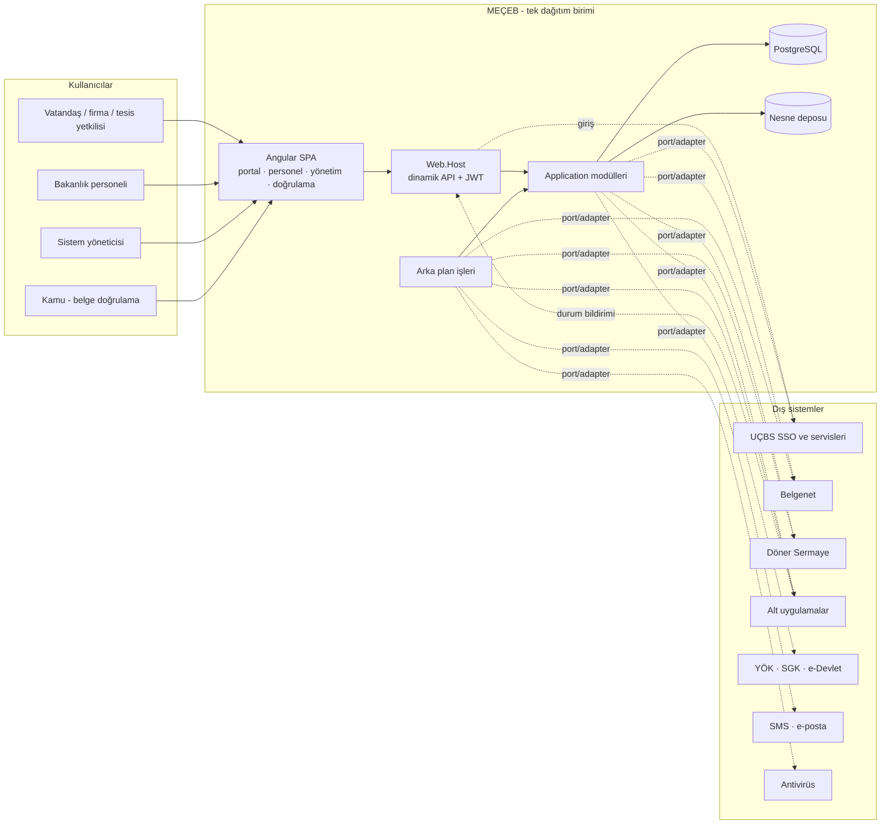
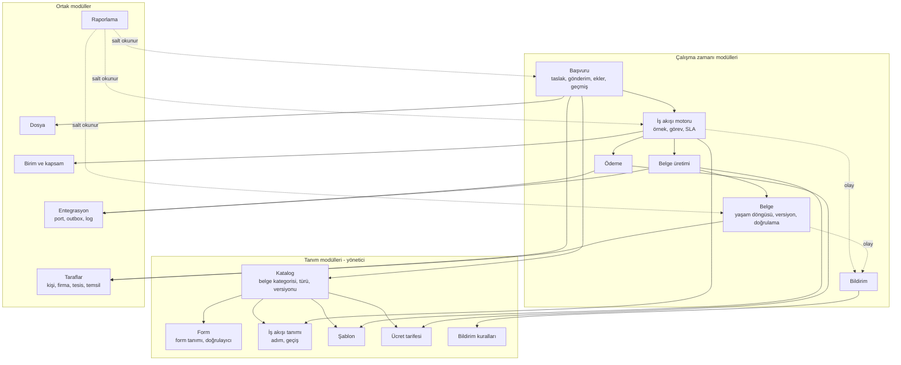
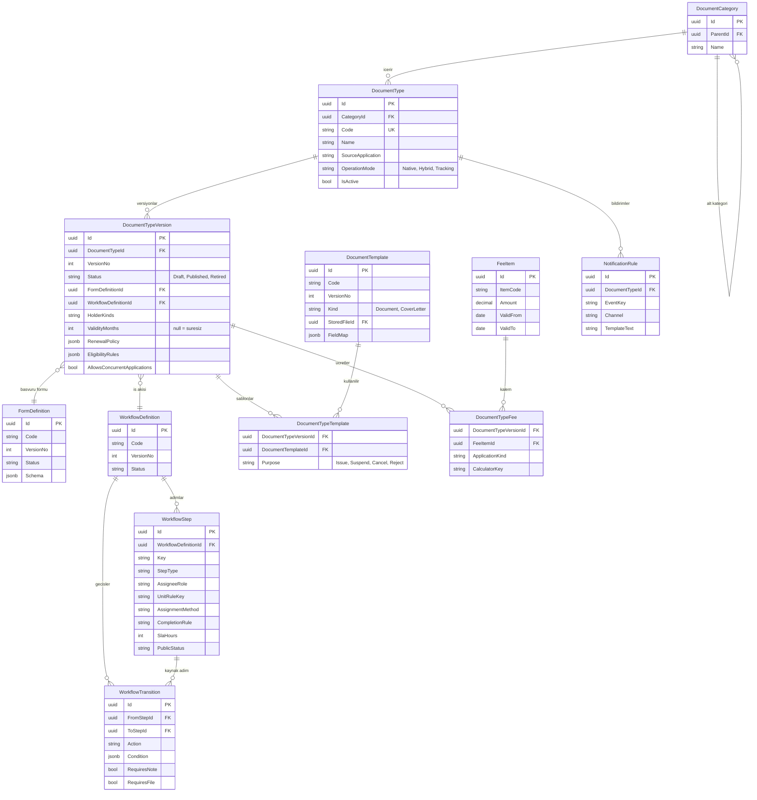
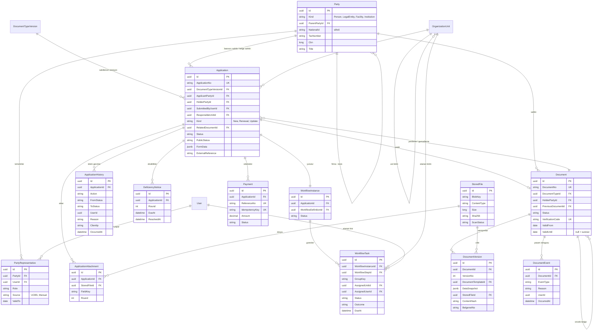
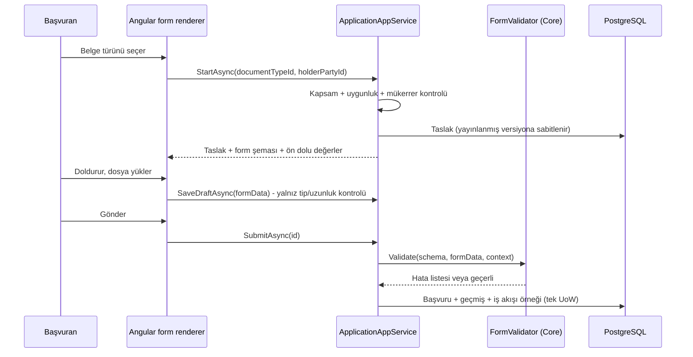
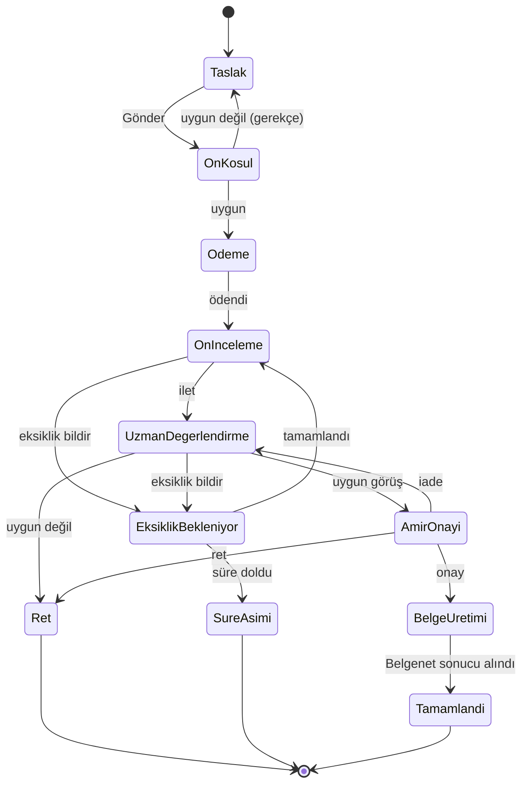
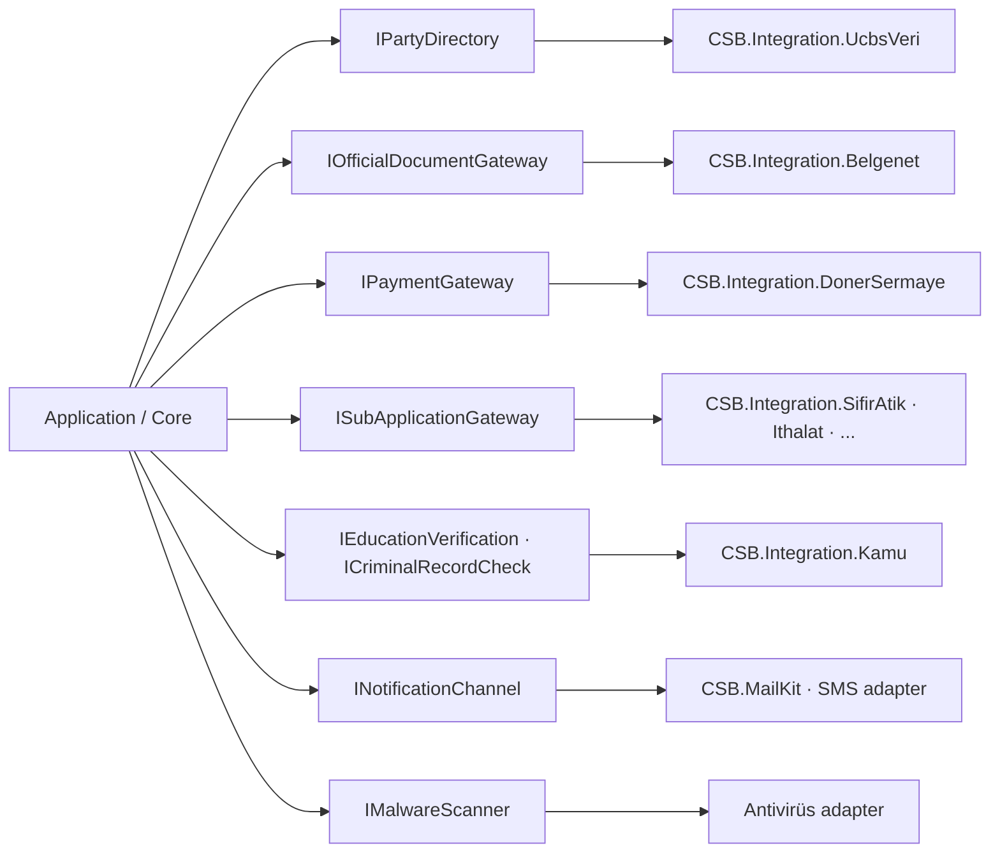
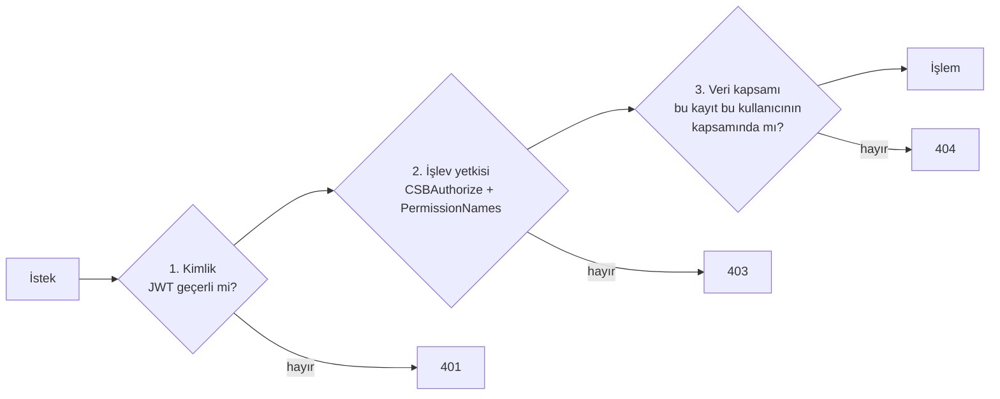
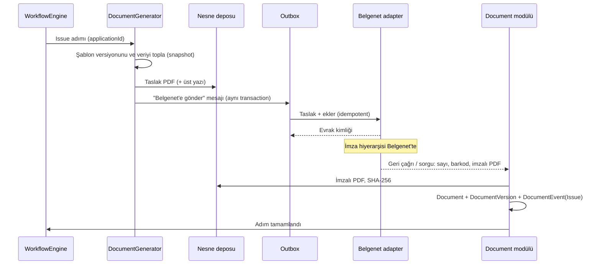
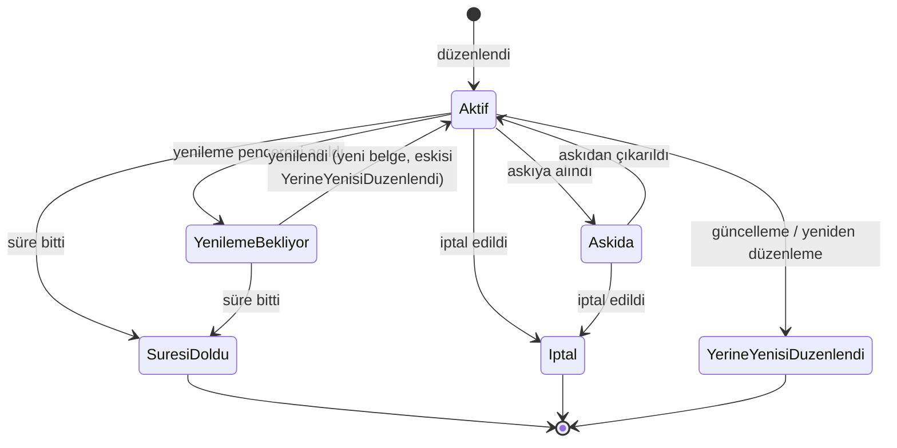

# Aşama 2 — Hedef Mimari

Bu doküman MEÇEB'in hedef mimarisini mevcut CSB framework şablonunun **gerçek** yapısına oturtur. Dayandığı
bulgular [01-mevcut-durum-analizi.md](01-mevcut-durum-analizi.md) içindedir. Kesinleşmesi bir yanıta bağlı olan
her nokta ilgili açık soru numarasıyla (AS-nn) işaretlenmiştir.

**Onay bekleyen kritik kararlar** §16'da toplanmıştır; bunlar onaylanmadan büyük çaplı kod değişikliğine başlanmamalıdır.

---

## 1. Mimari ilkeler

1. **Framework korunur.** Klasik ABP katmanları, AppService + `IRepository` + UoW, `[CSBAuthorize]`, `GridQueryBuilder`, `GenericResult` aynen kullanılır. CQRS/MediatR, yeni ORM, mikroservis eklenmez.
2. **Modüler monolit.** Tek dağıtım birimi; modüller klasör + namespace + arayüz sınırıyla ayrılır.
3. **Tanım ile çalışma zamanı ayrıdır.** Yöneticinin tanımladığı her şey (belge türü, form, iş akışı, şablon, ücret) versiyonludur ve yayınlandıktan sonra **değişmez**. Başvuru, başladığı versiyona sabitlenir.
4. **Metadata sınırlıdır.** Veritabanına *yapılandırma* konur, *program* konmaz. Karmaşık kurallar kodda yazılır, tanımda yalnızca adıyla seçilir (§6).
5. **Sunucu son sözü söyler.** Form doğrulaması, yetki ve kapsam kontrolü her zaman backend'de yapılır; frontend yalnızca kullanıcı deneyimidir.
6. **Kayıt kaybolmaz.** İşlem geçmişi yalnızca eklenir; üretilen belge değiştirilmez, yeni versiyonu üretilir.
7. **Dış sistemler kırılgandır.** Her entegrasyon port arkasındadır, idempotent çağrılır, kaydedilir ve erişilemediğinde ne olacağı tanımlıdır.

---

## 2. Genel mimari



Dağıtım bugünkü `docker/` düzenini izler: `meceb-web` (statik SPA) ve `meceb-api`. Arka plan işleri ilk aşamada
API süreci içinde çalışır; iş sunucusu ayrı bir konteyner olarak **aynı imajdan** ayağa kaldırılabilecek biçimde
yapılandırılır (yük artarsa ayrıştırmak kod değişikliği gerektirmez).

---

## 3. Katmanlar ve yerleşim

Yeni proje açılmaz; modüller mevcut projelerde klasör olarak yer alır. İstisna: dış sistem adapter'ları
`CSB.Integration.UcbsGiris` kalıbıyla `backend/integrations/` altında ayrı projedir.

| Katman (mevcut proje) | MEÇEB'de içerik |
| --- | --- |
| `CSB.ProjectName.Domain` | `Classes/<Modul>/` altında entity'ler (`FullAuditedEntity<Guid>`, `[Table("tbl_X")]`), değer nesneleri, enum'lar |
| `CSB.ProjectName.Core` | Yetki sabitleri, lokalizasyon, **port arayüzleri** (`Integration/`), iş akışı motoru ve form doğrulayıcı gibi domain servisleri, genişletme noktası arayüzleri |
| `CSB.ProjectName.Application` | `<Modul>/` altında AppService'ler ve DTO'lar; kapsam (scope) denetimi |
| `CSB.ProjectName.System` | Birim yönetimi gibi sistem servisleri (mevcut Users/Roles/Menus yanına) |
| `CSB.ProjectName.EntityFrameworkCore` | DbSet'ler, ilişkiler, `jsonb` eşlemeleri, migration, seed |
| `CSB.ProjectName.Web.Core` / `Web.Host` | Dosya yükleme/indirme ve anonim doğrulama controller'ları, geri çağrı (callback) uçları, iş sunucusu kaydı |
| `backend/integrations/CSB.Integration.*` | Belgenet, Döner Sermaye, UÇBS veri servisleri, alt uygulama adapter'ları |
| `frontend/src/app/modules/*` | `portal/`, `workspace/`, `definition/`, `verify/` özellik modülleri |
| `frontend/src/@core` | Dinamik form renderer'ı, dosya yükleme, sihirbaz gibi yeniden kullanılabilir bileşenler |

> **Not — Onion/Clean beklentisi.** Framework Onion değildir: `Core`, `Domain`'e referans vermez ve repository
> arayüzleri framework paketinden gelir. Bunu MEÇEB için dönüştürmek, framework ile çelişen büyük bir yeniden
> yapılandırma olurdu. Bunun yerine bağımlılık yönü **kural olarak** korunur: entity'ler dış sisteme, HTTP'ye veya
> EF'e bağımlı olmaz; dış sistemlere yalnızca `Core/Integration` altındaki arayüzlerle erişilir.

---

## 4. Modüller ve sınırlar



| Modül | Sorumluluk | Sahip olduğu veri | Sahip olmadığı |
| --- | --- | --- | --- |
| **Katalog** | Kademeli hizmet ağacı; belge türü ve versiyonları; izin verilen sahip türleri, süre, yenileme politikası, uygunluk kuralları | `DocumentCategory`, `DocumentType`, `DocumentTypeVersion` | Form ve akışın içeriği (yalnız referans tutar) |
| **Form** | Form tanımı şeması, sunucu tarafı doğrulama, seçenek kaynakları | `FormDefinition` | Başvuru verisi |
| **İş akışı** | Adım/geçiş tanımı; örnek ve görevlerin yürütülmesi; atama; SLA | `WorkflowDefinition/Step/Transition`, `WorkflowInstance`, `WorkflowTask` | Başvuru içeriği; belge |
| **Başvuru** | Taslak, gönderim, ekler, eksiklik turları, işlem geçmişi, dışa gösterilen durum | `Application`, `ApplicationAttachment`, `DeficiencyNotice`, `ApplicationHistory` | Görev ataması |
| **Belge** | Belge kaydı, durum geçişleri (yenileme, askı, iptal, süre dolumu), versiyonlar, doğrulama | `Document`, `DocumentVersion`, `DocumentEvent` | Şablon |
| **Şablon / Üretim** | Şablon versiyonları; veri birleştirme; PDF üretimi | `DocumentTemplate` | Resmî sayı (Belgenet'ten gelir) |
| **Ödeme** | Tarife, tutar hesaplama, ödeme emri, sonuç | `FeeItem`, `Payment` | Tahsilatın kendisi |
| **Taraflar** | Kişi, tüzel kişi, tesis; firma–tesis; kullanıcı–taraf temsil ilişkisi | `Party`, `PartyRepresentative` | Kullanıcı hesabı (framework `User`) |
| **Birim ve kapsam** | Birim ağacı, kullanıcı–birim, veri kapsamı denetimi | Framework `OrganizationUnit` + uzantı | Roller/yetkiler (framework) |
| **Dosya** | Yükleme, tarama, saklama, yetkili indirme | `StoredFile` | Dosyanın iş anlamı |
| **Entegrasyon** | Port arayüzleri, giden kutusu, çağrı kaydı, yeniden deneme | `OutboxMessage`, `IntegrationLog` | İş kuralı |
| **Bildirim** | Olay → kural → kanal; gönderim kaydı | `NotificationRule`, `NotificationLog` | — |
| **Raporlama** | Pano ve raporlar (salt okunur sorgular) | — | — |

**Modüller arası kurallar**

- Bir modül başka bir modülün entity'sini **değiştirmez**; o modülün uygulama/domain servisini çağırır.
- Başka modülün verisi yalnızca kimlikle (`Guid`) referans edilir; modüller arası EF navigation property kurulmaz (aynı modül içinde serbest). Bu, ileride bir modülü ayrı servise taşımayı mümkün kılar.
- Yan etkiler (bildirim, entegrasyon, raporlama güncellemesi) framework'ün `IEventBus`'ı üzerinden domain olaylarıyla tetiklenir; dış sisteme giden her şey **outbox**'tan geçer (§8).
- Bu kurallar bir mimari testle (`backend/test`) korunur: modül namespace'leri arası izinsiz referans testi kırar.

---

## 5. Veri modeli

Adlar öneridir; tablo adları `tbl_` önekiyle, anahtarlar `Guid` (framework tabloları kendi tipini korur).

### 5.1 Tanım tarafı



### 5.2 Çalışma zamanı tarafı



Ayrıca: `OutboxMessage`, `IntegrationLog`, `NotificationLog` (§8, §10).

### 5.3 Veri modeli kararları

| Karar | Gerekçe |
| --- | --- |
| Form verisi `Application.FormData` içinde `jsonb`; raporlanan/filtrelenen alanlar (`Status`, `HolderPartyId`, `ResponsibleUnitId`, tarihler) gerçek kolon | Belge türü başına tablo açmadan değişken form; sık sorgulanan alanlar indeksli. `GridQueryBuilder` yalnızca skaler property'lerde filtrelediği için liste ekranları bu kolonlarla çalışır |
| Tanım kayıtları versiyonlu ve yayın sonrası değişmez; `Application` → `DocumentTypeVersion` | Aktif başvuru eski form ve akışla tamamlanır; geriye dönük uyum |
| `Application` iki taraf tutar: `ApplicantPartyId` ve `HolderPartyId`; ayrıca `SubmittedByUserId` | "Başvuran", "belge sahibi" ve "işlemi yapan kullanıcı" üç ayrı kavram |
| `Party` tek tablo + `Kind`; tesis `ParentPartyId` ile firmaya bağlı | Bir firma çok tesis, bir tesis çok belge; kişi/firma/tesis aynı ilişkilere girer |
| `PartyRepresentative` kullanıcı ↔ taraf, kaynak ve geçerlilikle | Kullanıcı, kurum ve başvuru sahibi bağımsız modellenir; UÇBS'den gelen yetki ile elle tanımlanan ayrışır |
| Birim için framework `OrganizationUnit` kullanılır; "merkez/taşra", il kodu gibi ek alanlar uzantı tablosunda | Framework'te zaten var; yeniden yazılmaz (kullanılabilirliği AS-47 ile teyit edilecek) |
| `ApplicationHistory` ve `DocumentEvent` yalnızca eklenir (`CreationAuditedEntity`, güncelleme/silme yok) | Değiştirilemez iz; soft delete bu tablolarda anlamsız |
| `Document.PreviousDocumentId` zinciri | Yenilemede geçmiş kaybolmaz |
| TCKN şifreli saklanır, aramada hash kolonu kullanılır | KVKK; `App:EncryptionPassPhrase` altyapısı mevcut (`AppSecrets`) |

---

## 6. Dinamik form mimarisi

### 6.1 Alternatifler

| Seçenek | Artı | Eksi | Değerlendirme |
| --- | --- | --- | --- |
| **A. JSON Schema + hazır renderer** (ör. formly / json-schema-form) | Standart; hazır doğrulayıcı | Yeni frontend bağımlılığı (repoda yok); koşullu görünürlük, tablo, taraf/tesis seçici için yine özel uzantı; Angular 21 + Material uyumu ayrıca doğrulanmalı; aynı kuralların C# tarafında ikinci bir kütüphaneyle doğrulanması gerekir | Önerilmez |
| **B. Kendi kompakt metadata şeması** | Yalnızca gereken alan tipleri; mevcut Material + Reactive Forms ile render; tek şema hem TS hem C# tarafında okunur; framework'e bağımlılık eklemez | Renderer ve doğrulayıcı yazılacak | **Önerilen** |
| **C. EAV** (alan-değer tabloları) | SQL ile sorgulanır | Çok satır, yavaş, tablo/tekrarlı alanlarda karmaşık; versiyonlama zor | Önerilmez |
| **D. Belge türü başına tablo + kod** | En güçlü tip güvenliği | "Yeni belge türü için kod yazma" hedefiyle çelişir | Yalnızca istisnai, çok özel süreçler için |

### 6.2 Şema (öneri)

```json
{
  "schemaVersion": 1,
  "sections": [
    {
      "key": "company",
      "title": "Firma bilgileri",
      "visibleWhen": { "field": "$applicant.kind", "op": "in", "value": ["LegalEntity", "Facility"] },
      "fields": [
        { "key": "tradeName", "type": "text", "label": "Unvan", "required": true, "maxLength": 200,
          "prefill": "$holder.title", "readOnly": true },
        { "key": "serviceScope", "type": "select", "label": "Hizmet kapsamı", "required": true,
          "options": { "source": "static", "items": [{ "value": "A", "label": "A" }] } },
        { "key": "personnel", "type": "table", "label": "Teknik personel", "minRows": 1,
          "columns": [
            { "key": "nationalId", "type": "nationalId", "label": "T.C. kimlik no", "required": true },
            { "key": "role", "type": "select", "label": "Görev",
              "options": { "source": "lookup", "key": "personnel-roles" } }
          ] },
        { "key": "authorizationDoc", "type": "file", "label": "Yetki belgesi", "required": true,
          "accept": ["application/pdf"], "maxSizeMb": 10 }
      ]
    }
  ]
}
```

- **Alan tipleri:** `text`, `textarea`, `number`, `date`, `select`, `multiselect`, `checkbox`, `file`, `party`, `facility`, `address`, `nationalId`, `taxNumber`, `table`, `info` (beyan/taahhüt metni).
- **Kurallar:** `required`, `min/max`, `maxLength`, `pattern`, `visibleWhen`, `requiredWhen` — koşullar küçük, kapalı bir operatör kümesiyle (`eq`, `ne`, `in`, `gt`, `lt`, `empty`, `and`, `or`) yapısal JSON olarak ifade edilir. **Serbest ifade/script yoktur**: veritabanında çalıştırılabilir kod tutulmaz, enjeksiyon yüzeyi oluşmaz.
- **Seçenek kaynakları:** `static` (şemada), `lookup` (yönetilen kod listesi), `integration` (adlandırılmış port; ör. tesisin faaliyet kodları).
- **Ön doldurma:** `$applicant.*`, `$holder.*`, `$user.*` bağlam değişkenleri; UÇBS'den gelen alanlar `readOnly`.
- **Bağımlı alanlar:** seçenek kaynağı başka bir alanın değerini parametre alabilir (il → ilçe).

### 6.3 Çalışma biçimi



- **Renderer** `@core` altında yeni, yeniden kullanılabilir bir bileşen ailesidir: alan tipi → bileşen kayıt defteri; şemadan `FormGroup` üretir; `visibleWhen` değişimlerini signal'lerle izler. Mevcut `mat-form-field`, `CoreLuxonDateAdapter` ve `translate` pipe'ı kullanılır.
- **Doğrulayıcı** `Core` katmanında saf C# sınıfıdır (dış bağımlılığı yok, birim testi kolay). Frontend doğrulaması yalnızca hızlı geri bildirimdir.
- Şemada **tanımlı olmayan alanlar reddedilir** (toplu atama / fazla veri gönderimine karşı).
- **Taslak** eksik veriyle kaydedilebilir; tam doğrulama yalnızca gönderimde.
- **Form tasarım ekranı** iki fazlıdır: önce bölüm/alan listesi + özellik paneli + canlı önizleme (sürükle-bırak yok); gerekirse sonra görsel yerleşim. Gerekçe: değer, alanları tanımlayabilmekte; sürükle-bırak pahalı ve pilot için gereksiz.

### 6.4 Form versiyonlama

Yayınlanmış `FormDefinition` değişmez. Değişiklik = yeni versiyon → yeni `DocumentTypeVersion`. Taslak başvurular
başladıkları versiyonda kalır; yönetici isterse "taslakları yeni versiyona taşı" işlemini bilinçli olarak tetikler
(uyumsuz alanlar raporlanır). Gönderilmiş başvurular asla taşınmaz.

---

## 7. İş akışı mimarisi

### 7.1 BPMN editörü mü, durum/geçiş tanımı mı?

| Ölçüt | BPMN motoru + görsel editör | Durum/geçiş + görev tabloları |
| --- | --- | --- |
| İfade gücü | Çok yüksek (olay, alt süreç, telafi, zamanlayıcı) | Sıralı, koşullu dallanma, geri dönüş, paralel grup — kaynaklardaki tüm akışlara yeter |
| Yeni teknoloji | Motor (Camunda/Elsa vb.) veya sıfırdan BPMN yorumlayıcı; framework'te yok | Yok; EF entity + AppService |
| Yönetici için öğrenme | BPMN bilgisi gerekir; "teknik bilgisiz tanım" hedefiyle çelişir | Tablo/form: adım ekle, sonraki adımı seç |
| Geçersiz model riski | Yüksek (ölü uç, sonsuz döngü, eşleşmeyen geçit) | Düşük; yayın öncesi basit doğrulama yeter |
| Versiyonlama / aktif örnekler | Motorun kendi göç mekanizması | Örnek tanım versiyonuna sabit; basit |
| Yetki ve kapsamla bütünleşme | Motor dışı; köprü gerekir | Aynı veritabanı ve aynı UoW içinde |
| Test edilebilirlik | Motor bağımlı | Saf domain servisi, in-memory test |
| Maliyet | Yüksek | Düşük |

**Öneri: durum/geçiş + görev modeli.** Excel'deki ve diyagramdaki akışların tamamı "sıralı adımlar + koşullu
yönlendirme + eksiklik döngüsü + hiyerarşik onay" kalıbındadır; BPMN'in ek gücüne ihtiyaç gösteren bir örnek yok.
Görsellik için akış, `@csb/diagrams` ile **salt-okunur** çizilir (tanımdan otomatik üretilir); yönetici düzenlemeyi
tablo/formdan yapar. Görsel düzenleme ileride aynı veri modeli üzerine eklenebilir — model BPMN'e değil, kendi
tablolarımıza bağlı olduğu için bu bir kilitlenme yaratmaz.

### 7.2 Model

- **Adım tipleri:** `Auto` (kod kancası: ön koşul, entegrasyon), `Payment`, `ApplicantAction` (eksiklik giderme, imza), `Review` (inceleme), `Approval` (onay), `Sign` (imza/Belgenet), `Issue` (belge üretimi), `End`.
- **Geçiş:** `(kaynak adım, eylem, koşul) → hedef adım`. Eylemler: `Submit`, `Approve`, `Reject`, `ReturnToApplicant`, `ReturnToPrevious`, `Forward`, `Complete`, `Timeout`.
- **Koşul:** form şemasındaki aynı kapalı operatör kümesi; başvuru alanlarına ve bağlama bakar (ör. `category == "A"`).
- **Atama:** adımda `AssigneeRole` + `UnitRuleKey` + `AssignmentMethod`:
  - `UnitRuleKey` kayıtlı bir birim çözümleyicidir: `IssuingUnit`, `ProvincialDirectorateOfFacility`, `ByFormField`, `ParentOfPreviousUnit` …
  - `AssignmentMethod`: `Pool` (birim havuzu, üstlenme), `RoundRobin`, `LeastLoaded`, `Manual` (amir atar), `SameAsStep` (önceki adımı yapan).
- **Paralel değerlendirme:** bir adım birden fazla görev üretir (`GroupKey` ortak); `CompletionRule` = `All` / `Any` / `Majority`. Ayrı bir "geçit" kavramı yoktur.
- **SLA:** `SlaHours`; arka plan işi `DueAt` yaklaşan/aşan görevler için bildirim ve (tanımlıysa) `Timeout` geçişi üretir. Başvuranı bekleyen adımlarda birim sayacı durur.
- **Adım zorunlulukları:** `RequiresNote`, `RequiresFile` geçiş üzerinde.
- **Dışa görünen durum:** her adımın `PublicStatus` değeri vardır (kapsam dokümanındaki sade durumlar: Başvuru Alındı, Ödeme Bekleniyor, Değerlendiriliyor, Eksiklik Bildirildi…). Başvuran teknik adımı değil bunu görür.

Örnek (pilot için taslak; onay makamı AS-08'e bağlı):



### 7.3 Motor

`WorkflowEngine` `Core` katmanında bir domain servisidir; tek giriş noktası `ExecuteAsync(taskId, action, note, files)`:

1. Görevi kilitleyerek okur (eşzamanlı çift tıklama/çift onaya karşı iyimser eşzamanlılık: `ConcurrencyStamp`).
2. Çağıranın bu görevde bu eylemi yapma yetkisini doğrular (rol + birim + atama).
3. Geçişi bulur, koşulu değerlendirir, zorunlulukları denetler.
4. Görevi kapatır; grup tamamlanma kuralını uygular; hedef adımın görev(ler)ini üretir ve atar.
5. `ApplicationHistory` satırı yazar; `Application.Status/PublicStatus` günceller.
6. Domain olayı yayınlar (bildirim, entegrasyon outbox).

Hepsi tek UoW içinde. `Auto` adımlar kod kancası çalıştırır; dış çağrı gerektirenler **senkron beklemez**: outbox'a
yazılır, görev "bekliyor" kalır, sonuç gelince motor yeniden tetiklenir (§8.3).

### 7.4 Kod ile metadata dengesi: genişletme noktaları

| Genişletme noktası | Arayüz (Core) | Tanımda nasıl seçilir | Örnek |
| --- | --- | --- | --- |
| Uygunluk / ön koşul | `IEligibilityCheck` | `EligibilityRules: [{ key, params }]` | YÖK mezuniyet, Sıfır Atık "başvuru yapabilir", aktif belge var mı |
| Ücret hesaplama | `IFeeCalculator` | `CalculatorKey` | İlk başvuru ücretsiz, yenileme tarifeli |
| Birim çözümleme | `IUnitResolver` | `UnitRuleKey` | Tesisin ilindeki il müdürlüğü; A kategori → merkez |
| Otomatik adım | `IWorkflowStepHandler` | `StepType: Auto` + `HandlerKey` | Alt uygulamaya durum bildir |
| Seçenek kaynağı | `IOptionSource` | `options.source: integration` | Tesisin atık kodları |
| Belge verisi zenginleştirme | `IDocumentDataContributor` | Şablon `FieldMap` | Tesis adresi, yetkili adı |

Hepsi framework kuralıyla (`ITransientDependency`) otomatik kaydedilir ve anahtarla çözülür; yönetim arayüzü mevcut
anahtarları ve parametre şemalarını listeler. **Yeni bir belge türü mevcut anahtarlarla tanımlanabiliyorsa kod
yazılmaz; yeni bir kural gerekiyorsa küçük bir sınıf eklenir, platform değişmez.** Bu, "tüm iş kurallarını
veritabanına taşıma" ile "her belge için kod yazma" arasındaki dengedir.

---

## 8. Entegrasyon mimarisi

### 8.1 Port / adapter



- Port arayüzleri `Core/Integration/` altındadır ve yalnızca MEÇEB'in kendi tiplerini kullanır; domain/uygulama kodu dış sistemin DTO'sunu görmez.
- Adapter'lar `backend/integrations/` altında ayrı projedir, `CSB.Integration.UcbsGiris` ile aynı kalıpta paketlenir ve bir modül sınıfıyla kaydolur.
- Her port için bir **sahte (fake) adapter** bulunur: geliştirme, test ve dış sistem hazır olmadan pilot çalıştırma için. Hangi adapter'ın aktif olduğu config ile seçilir.
- Entegrasyon anahtarları `AppSecrets` kalıbıyla yalnızca ortam değişkeni / gizli yönetiminden okunur (bkz. F-1).

### 8.2 Alt uygulamalarla üç mod

| Mod | MEÇEB → alt uygulama | Alt uygulama → MEÇEB |
| --- | --- | --- |
| Yerel | Belge üretildiğinde (istenirse) arşiv aktarımı | — |
| Hibrit | Uygunluk sorgusu; başvuru numarası ve UÇBS bağlamıyla **yönlendirme**; durum bildirimi | Form tamamlandı / inceleme sonucu geri çağrısı |
| İzleme | — | Aşama değişikliği bildirimi |

> **Güvenlik uyarısı.** Kapsam dokümanı yönlendirmede Tesis ID, ÇKN, VKN, **T.C. kimlik no** ve UÇBS oturum
> anahtarlarının **URL parametresiyle** aktarılmasını öngörüyor. Kimlik numarası ve oturum anahtarı URL'de taşınmamalı
> (tarayıcı geçmişi, proxy/sunucu logları, `Referer` sızıntısı). Öneri: MEÇEB tek kullanımlık, kısa ömürlü, imzalı
> bir **devir kodu** üretir; alt uygulama bu kodu sunucudan sunucuya çağrıyla bağlam verisine çevirir. Karar: §16 K-9.

Alt uygulamadan gelen çağrılar ayrı bir `api/integration/*` yüzeyinde, uygulama bazlı kimlik bilgisiyle (istemci
kimliği + imza) karşılanır, yalnızca o uygulamaya ait belge türlerinde işlem yapabilir ve `IntegrationLog`'a yazılır.

### 8.3 Güvenilirlik

| Konu | Tasarım |
| --- | --- |
| **Outbox** | Dış sisteme giden her komut, iş verisiyle **aynı transaction'da** `OutboxMessage` olarak yazılır; arka plan işi gönderir. Böylece "veritabanı güncellendi ama çağrı gitmedi" durumu oluşmaz |
| **Idempotency** | Her mesajda kalıcı `IdempotencyKey` (ör. `payment:{applicationId}:{attempt}`); adapter karşı tarafa iletir; geri çağrılar aynı anahtarla ikinci kez işlenmez (`Payment.IdempotencyKey`, `IntegrationLog.CorrelationId` benzersiz) |
| **Retry** | Üstel geri çekilme, sınırlı deneme; tükenince mesaj "başarısız" kuyruğuna düşer, yöneticiye görünür ve elle yeniden denenebilir |
| **Zaman aşımı / devre kesici** | Her adapter çağrısında süre sınırı; ardışık hatada kısa süre çağrı yapılmaz |
| **Kayıt** | `IntegrationLog`: sistem, işlem, korelasyon, süre, sonuç, deneme. **Gövde maskelenir**; kimlik no, token, şifre yazılmaz |
| **Mutabakat** | Ödeme ve Belgenet için periyodik "bekleyenleri sorgula" işi; geri çağrı kaybolsa da durum yakalanır |

**Dış sistem erişilemezse davranış**

| Durum | Davranış |
| --- | --- |
| UÇBS giriş servisi yok | Giriş yapılamaz; açık oturumlar çalışmaya devam eder |
| Uygunluk sorgusu (YÖK, alt uygulama) yok | Belge türünde tanımlı politika: **`Block`** (varsayılan — "şu anda ulaşılamıyor, daha sonra deneyin"; taslak korunur) veya **`Defer`** (başvuru alınır, kontrol ilk iş akışı adımında yeniden denenir) |
| Ödeme sistemi yok | Başvuru "Ödeme Bekleniyor"da kalır; referans no geçerliliğini korur |
| Belgenet yok | Onay tamamlanır, belge üretimi adımı "bekliyor" kalır, otomatik yeniden denenir; başvuran "Değerlendiriliyor" görür |
| Antivirüs yok | Dosya `Pending` kalır; taranmamış dosya **indirilemez** ve başvuru gönderilemez |
| SMS / e-posta yok | Yeniden denenir; uygulama içi bildirim her durumda yazılır |

### 8.4 Arka plan işleri

Yerel feed'deki `CSB.HangFire` devreye alınır (PostgreSQL depolama; yeni altyapı gerektirmez). İşler: outbox
gönderimi, SLA denetimi, belge süre denetimi (yaklaşıyor / doldu), eksiklik süre aşımı, ödeme/Belgenet mutabakatı,
bildirim gönderimi, dosya taraması. Hangfire panosu yalnızca yönetici yetkisiyle ve iç ağdan erişilebilir. Paketin
desteklendiği framework ekibiyle teyit edilmeli (AS-47); desteklenmiyorsa yedek seçenek framework'ün yerleşik
`CSBBackgroundJobs` yöneticisidir (zamanlanmış/tekrarlı iş desteği daha zayıf).

---

## 9. Yetkilendirme mimarisi

### 9.1 Üç katman



1. **Kimlik:** UÇBS SSO → JWT (mevcut).
2. **İşlev yetkisi:** mevcut statik permission sistemi. Yeni yetkiler `PermissionNames` + `ProjectNameAuthorizationProvider` + iki lokalizasyon XML'ine eklenir. Örnek aile: `Pages.Applications`, `Pages.Applications.Evaluate`, `Pages.Applications.Approve`, `Pages.Documents`, `Pages.Documents.Suspend`, `Pages.Documents.Cancel`, `Pages.Definitions.DocumentTypes(.Manage/.Publish)`, `Pages.Definitions.Workflows(.Manage)`, `Pages.Reports`, `Pages.Integration.Logs`.
3. **Veri kapsamı (yeni):** framework'te satır bazlı yetki yok; eklenir.

### 9.2 Kapsam modeli

| Aktör | Kapsam kuralı |
| --- | --- |
| Başvuran (kişi) | Kendi `Party`'si adına olan başvuru ve belgeler |
| Firma / tesis yetkilisi | Geçerli `PartyRepresentative` kaydı olan taraflar (ve firmaya bağlı tesisler) |
| Bakanlık personeli | Üyesi olduğu birim(ler) ve alt birimleri **∩** rolüne tanımlı belge türleri; ayrıca kendisine atanmış görevler |
| Denetleyici / salt okunur | Tanımlı birim ve belge türü kümesinde yalnız okuma |
| Sistem yöneticisi | Tanım ekranları; başvuru içeriğine erişimi ayrıca yetkiye bağlı (yönetici ≠ her veriyi görür) |

Uygulama biçimi:

- Tek bir servis: `IDataScopeService`. İki işlev sunar: `IQueryable<T> Apply(IQueryable<T>)` (liste sorgularını daraltır) ve `Task CheckAsync(entity, operation)` (tekil erişimde zorlar).
- **Kural:** başvuru, belge, dosya, ödeme döndüren veya değiştiren her AppService metodu bu servisten geçer. Liste uçlarında `_repository.GetTableAll(input)` sonucu kapsamla daraltılır; `TotalCount` daraltılmış küme üzerinden hesaplanır.
- Kapsam dışı kayıt için **404** dönülür (kaydın varlığı sızdırılmaz).
- Kimlikler `Guid` olduğu için tahmin edilemez; ancak güvenlik buna dayanmaz, her erişimde kapsam denetlenir.
- Bir mimari test, `Application`/`Document`/`StoredFile` repository'sini enjekte eden her AppService'in `IDataScopeService` kullandığını doğrular (unutulan kontrol = kırılan test). Her uç için "başka tarafın kaydına erişim reddedilir" testi yazılır.
- Rol ↔ belge türü kapsamı için küçük bir tablo: `RoleDocumentTypeScope (RoleId, DocumentTypeId veya CategoryId)`.

### 9.3 "Kimin adına" bağlamı

- Kullanıcı girişte veya portal üst çubuğundan **işlem yaptığı tarafı** seçer (kendisi / yetkili olduğu firma veya tesis). Seçim sunucuda her istekte `PartyRepresentative` ile doğrulanır; istemcinin gönderdiği taraf kimliğine güvenilmez.
- `PartyRepresentative` kayıtları `UcbsLoginContributor<User>` ile her UÇBS girişinde eşitlenir (bugün yalnızca oturumdaki tek tesis; UÇBS yetkili olunan taraf listesini verebiliyorsa tamamı — AS-30). Kaynağı `UCBS` olan kayıtlar elle değiştirilemez.
- Personelin birim üyeliği: UÇBS/İK birim servisi varsa girişte eşitlenir; yoksa yönetim ekranından atanır (AS-30).

### 9.4 Roller

Başlangıç rolleri öneridir ve UÇBS rolleriyle `Ucbs:RoleMappings` üzerinden eşlenir; hiçbiri `IsDefault` yapılmaz.

| Rol | Tipik yetkiler |
| --- | --- |
| Başvuru Sahibi | Katalog, başvuru oluşturma, kendi başvuru ve belgeleri |
| Uzman | İş listesi, değerlendirme, eksiklik bildirimi, uygun görüş |
| Şube Müdürü / Daire Başkanı / İl Müdürü | + onay, ret, iade, birim içi atama |
| Belgelendirme Yöneticisi | Belge askıya alma, iptal, süre düzeltme (gerekçeli) |
| Tanım Yöneticisi | Belge türü, form, iş akışı, şablon, ücret tanımı ve yayını |
| Sistem Yöneticisi | Kullanıcı/rol/birim, entegrasyon izleme, parametreler |
| Denetleyici | Salt okunur erişim, işlem geçmişi, raporlar |

"Merkez personeli / taşra personeli" ayrı rol değil, **birim üyeliğinin** sonucudur. "Firma yetkilisi / tesis
yetkilisi" de rol değil, **temsil ilişkisinin** sonucudur. Bu, rol patlamasını (her il × her görev için rol) önler.

### 9.5 Yetki değişikliklerinin izlenmesi

Rol, yetki, birim üyeliği ve temsil ilişkisi değişiklikleri için framework'ün entity history özelliği **bu
entity'lerle sınırlı olarak** açılır (seçici eklenir); ayrıca F-2 (yetki yükseltme açığı) kapatılır.

---

## 10. Belge üretimi ve yaşam döngüsü

### 10.1 Üretim hattı



| Konu | Tasarım |
| --- | --- |
| Şablon | Belge türü versiyonu başına amaç bazlı şablonlar (düzenleme, askı, iptal, ret üst yazısı). Şablon versiyonludur; yayınlanan değişmez |
| Şablon biçimi | Karar bekliyor (K-6). **Öneri:** DOCX şablon + alan yer tutucuları; sunucuda PDF'e dönüştürme. Frontend'de `@csb/documenteditor` düzenleme için aday. Sunucu tarafı DOCX→PDF dönüşümü için hangi kütüphane/servisin kurumda mevcut olduğu doğrulanmadı |
| Dinamik alanlar | `FieldMap`: yer tutucu → veri yolu (`application.form.tradeName`, `holder.title`, `document.validUntil`, `evaluation.result`…). Yalnızca tanımlı yollar; serbest ifade yok |
| Anlık görüntü | Üretim anındaki veri `DocumentVersion.DataSnapshot`'ta, kullanılan şablon `DocumentTemplateId`'de saklanır → belge yıllar sonra da aynı veriyle açıklanabilir |
| Değişmezlik | Üretilen dosyanın SHA-256'sı saklanır; indirirken doğrulanır. Düzeltme = yeni `DocumentVersion` (yeni Belgenet evrakı), eskisi "geçersiz kılındı" olarak kalır |
| Belge numarası | Resmî sayı Belgenet'ten alınır (Ç-10). MEÇEB kendi **takip numarasını** üretir (belge türü tanımındaki kalıp: ör. `{TÜR}-{YIL}-{SIRA}`; veritabanı sequence'i ile, boşluksuz olma zorunluluğu AS ile netleşecek) |
| QR / doğrulama | `VerificationCode` uzun ve rastgeledir (belge numarasından türetilmez). Anonim `/dogrula/{kod}` sayfası yalnızca gereken asgari bilgiyi gösterir: belge türü, sahibi (maskeli), durum, geçerlilik. QR'ın Belgenet'e mi MEÇEB'e mi gideceği AS-39 |
| E-imza | Kurum imzası Belgenet akışındadır. Başvuranın e-imzası (gerekiyorsa) iş akışında `ApplicantAction` adımıdır; imzalanan içerik ve imza dosyası `StoredFile` olarak saklanır, imza doğrulaması sunucuda yapılır (altyapı AS-38) |
| Çıktısız belgeler | AATBEL, GBF gibi "çıktı yok" türlerinde `Issue` adımı dosya üretmeden yalnızca `Document` kaydı (durum + geçerlilik) oluşturur |

### 10.2 Belge yaşam döngüsü

Belge yaşam döngüsü başvuru iş akışından **ayrı** bir domain'dir: başvuru biter, belge yıllarca yaşar.



- Durum kümesi sabittir (kod); **izin verilen geçişler ve koşulları belge türüne göre tanımlanır** (ör. "askıya alma yok", "yenileme penceresi 180 gün", "süresiz").
- Her geçiş bir `DocumentEvent` üretir (kim, ne zaman, gerekçe).
- **Yenileme, uzatma, bilgi güncelleme, sahip değişikliği, yeniden düzenleme** birer *başvuru türüdür* (`Application.Kind` + `RelatedDocumentId`): aynı form/iş akışı altyapısından geçer, kendi akış tanımı olabilir, sonunda yeni `Document` (veya yeni `DocumentVersion`) üretir ve `PreviousDocumentId` ile zincirlenir.
- **Askıya alma / iptal** yetkili personelin başlattığı kısa bir iş akışıdır (gerekçe → onay → üst yazı → Belgenet).
- **Süre takibi** günlük arka plan işidir: yenileme penceresi açılışı, yaklaşma bildirimleri (tanımlı günlerde), süre dolumu. Süresiz belgelerde `ValidUntil = null`.
- Alt uygulamada oluşan durum değişikliği (denetim sonucu askı gibi) entegrasyon yüzeyinden gelir ve aynı geçiş kurallarından geçer.

---

## 11. Ödeme, bildirim, raporlama

**Ödeme.** `Payment` adımı iş akışında bir adımdır; ödeme gerektirmeyen belge türünde adım yoktur. Tutar
`IFeeCalculator` ile hesaplanır; 0 ise adım otomatik geçilir. Akış: ödeme emri + referans no → başvuran döner sermaye
ödeme sayfasına yönlendirilir → sonuç geri çağrı **ve** mutabakat işiyle alınır → idempotent işlenir. Ödenmemiş başvuru
inceleme adımına geçemez (motor kuralı). İade/iptal ayrı bir komut ve kayıttır; teknik sözleşme AS-37.

**Bildirim.** Domain olayı (`ApplicationSubmitted`, `DeficiencyNotified`, `TaskAssigned`, `Approved`, `Rejected`,
`DocumentIssued`, `DocumentExpiring`, `DocumentExpired`, `RenewalWindowOpened`, `TaskOverdue`) → `NotificationRule`
(belge türü + olay + kanal + metin şablonu) → kanal adapter'ı. Kanallar: uygulama içi (framework bildirim tabloları
+ mevcut SignalR hub'ı), e-posta (`CSB.MailKit`), SMS (adapter; AS-40). Gönderimler `NotificationLog`'a yazılır.
Metin şablonlarında kişisel veri en azda tutulur (SMS'te kimlik no, belge içeriği yer almaz).

**Raporlama.** İlk aşamada doğrudan PostgreSQL üzerinde, indeksli kolonlara dayanan sorgular (başvuru sayısı, tür
dağılımı, aktif/süresi yaklaşan/dolmuş belge, bekleyen/reddedilen, birim iş yükü, ortalama sonuçlanma süresi,
gecikenler). Tüm raporlar `IDataScopeService` kapsamıyla filtrelenir. Hacim büyürse özet tabloları veya okuma
replikası; şimdiden ayrı bir raporlama veritabanı kurulmaz (aşırı mühendislik).

---

## 12. Güvenlik mimarisi

| Risk / gereksinim | Önlem |
| --- | --- |
| Kimlik doğrulama | UÇBS SSO; yerel parola girişi üretimde yalnızca acil durum yönetici hesabı için (karar K-11). Token ömrü kısaltılır, yenileme/iptal eklenir (F-4) |
| Yetkisiz erişim, **IDOR/BOLA** | §9.2: her tekil erişimde kapsam denetimi; kapsam dışına 404; mimari test + uç başına negatif test |
| Yetki yükseltme | F-2 kapatılır: rol/yetki atamada "çağıran bu yetkiye sahip mi" kontrolü; mevcut `UserAppService` korumaları korunur |
| Enjeksiyon | EF parametreli sorgular; grid filtrelerinde yalnızca `GridQueryBuilder`; form koşullarında serbest ifade yok; `jsonb` sorguları parametreli |
| XSS | Angular varsayılan kaçışı; `cellRenderer`'larda `escapeHtml`; form/şablon metinlerinde `CSB.HtmlSanitizer`; bildirim şablonları düz metin |
| CSRF | Mevcut antiforgery filtresi; token `Authorization` başlığında |
| **Dosya yükleme** | İzin listesi (uzantı + içerik imzası/magic byte + MIME); belge türü tanımından boyut/adet sınırı; rastgele depolama anahtarı (kullanıcı dosya adı yol olarak kullanılmaz); web kökünün dışında nesne deposu; **karantina → antivirüs → temiz** akışı, temiz olmayan indirilemez; indirme `Content-Disposition: attachment` + `nosniff`; indirme yetkisi kapsam denetiminden geçer; süreli, tek kayıtlık erişim |
| Hassas / kişisel veri | TCKN şifreli + hash'li arama kolonu; arayüzde ve raporlarda maskeleme (rol bazlı açma, açma işlemi kayıtlı); veri minimizasyonu; saklama süresi sonunda anonimleştirme işi (AS-44) |
| Log'larda hassas veri | Bağlantı cümlesi, token, şifre, kimlik no, dosya içeriği loglanmaz (CLAUDE.md kuralı); entegrasyon gövdeleri maskelenir; framework audit log'unda hassas DTO alanlarına `[DisableAuditing]` |
| **Denetim izi** | `ApplicationHistory` / `DocumentEvent`: kim, ne zaman, hangi işlem, hangi gerekçe, IP. Yalnızca ekleme; veritabanı kullanıcısının bu tablolarda `UPDATE/DELETE` yetkisi kaldırılır; her satır bir öncekinin hash'ini taşır (zincir) → değişiklik tespit edilebilir |
| E-imza bütünlüğü | İmzalı dosyanın hash'i saklanır; her indirmede/doğrulamada karşılaştırılır; imza doğrulaması sunucuda |
| Rate limiting | ASP.NET Core yerleşik rate limiter (yeni bağımlılık değil): giriş, anonim doğrulama, dosya yükleme, entegrasyon uçları için ayrı politikalar |
| Anonim doğrulama sayfası | Tahmin edilemez kod, hız sınırı, asgari bilgi, numaralandırmaya karşı tekdüze yanıt |
| API güvenliği | HTTPS zorunlu + HSTS; CORS yalnızca tanımlı kökenler; Swagger üretimde kapalı; şemada olmayan alanların reddi; sayfa boyutu üst sınırı (mevcut 1000) |
| Gizli anahtarlar | `AppSecrets` kalıbı; **F-1 giderilir**; entegrasyon anahtarları ortam/gizli yönetiminden; depoda gizli anahtar taraması CI'a eklenir |
| Veritabanı erişimi | Uygulama kullanıcısı en az yetkiyle; migration ayrı kullanıcıyla (Migrator); bağlantı TLS ile |
| Yedekleme / felaket kurtarma | PostgreSQL PITR + nesne deposu sürümleme; geri yükleme tatbikatı; hedefler AS-45 |
| Bağımlılıklar | Yeni üçüncü taraf paket eklenmeden önce gerekçe; yerel feed ve kurumsal Nexus dışında kaynak yok |

---

## 13. Frontend mimarisi

| Alan | Rota | Yerleşim | Kitle |
| --- | --- | --- | --- |
| Portal | `/portal/*` | Sade üst menülü yerleşim (Fuse yatay yerleşimlerinden biri) | Vatandaş, firma, tesis |
| Personel | `/workspace/*` | Mevcut dikey Fuse kabuğu | Bakanlık personeli |
| Yönetim | `/definition/*`, mevcut `/admin/*` | Mevcut dikey kabuk | Tanım ve sistem yöneticisi |
| Doğrulama | `/dogrula/:kod` | Boş yerleşim, **korumasız** | Herkes |

- Tek SPA; alanlar lazy-loaded modüllerdir ve rota `Authorize({ claims: [...] })` ile korunur. Girişten sonra kullanıcı rolüne göre uygun alana yönlendirilir.
- Menü mevcut `GetAuthorizedTree` ile gelir; yeni menüler migration ile eklenir (CLAUDE.md kuralı).
- Listeler `FSearchBase` + `getTableAll`; küçük formlar `FormDialogBase`. Başvuru sihirbazı, dinamik form, dosya yükleme `@core` altında yeni ortak bileşenlerdir.
- Proxy'ler NSwag ile üretilir; dosya yükleme/indirme için elle yazılmış ince bir servis gerekir (proxy'lerde multipart yok).
- Bilinmeyen anonim URL'lerin girişe yönlenmesi (catch-all) doğrulama rotası için ayrıca ele alınır.

---

## 14. Tasarım desenleri

| Desen | Nerede | Neden |
| --- | --- | --- |
| Modüler monolit | Tüm backend | Tek ekip, tek dağıtım; sınırlar net, ileride ayrıştırılabilir |
| Application Service + Repository + UoW | Tüm modüller | Framework'ün kalıbı |
| Durum makinesi | İş akışı motoru, belge yaşam döngüsü | Geçişlerin tek yerde, denetlenebilir yönetimi |
| Strateji + kayıt defteri (anahtarla çözüm) | Genişletme noktaları (§7.4) | Metadata'da program tutmadan özelleştirme |
| Port / adapter | Entegrasyonlar | Domain'in dış sistemden yalıtımı; sahte adapter ile test |
| Transactional outbox | Dış çağrılar, bildirimler | Veri ile mesajın tutarlılığı; yeniden deneme |
| Idempotent alıcı | Geri çağrılar, ödeme | Mükerrer işlemin önlenmesi |
| Değişmez versiyon + anlık görüntü | Tanımlar, üretilen belge | Geriye dönük uyum, kanıt değeri |
| Yalnızca eklenen kayıt | İşlem geçmişi | Denetlenebilirlik |
| Spesifikasyon (kapalı koşul dili) | Form/iş akışı koşulları | Güvenli, doğrulanabilir kurallar |

Bilinçli olarak **kullanılmayanlar**: CQRS/MediatR, event sourcing, BPMN motoru, mikroservis, ayrı okuma modeli,
genel amaçlı kural motoru/script. Hiçbirini gerektiren bir gereksinim kaynaklarda görülmedi.

---

## 15. Framework eksikleri ve iyileştirme önerileri

| # | Eksik | Öneri | Zamanlama |
| --- | --- | --- | --- |
| İ-1 | Git'te gizli anahtarlar (F-1) | Anahtarları değiştir; dosyayı gizli yönetimine taşı; CI'a gizli anahtar taraması | **Hemen** |
| İ-2 | Rol/yetki atamada yükseltme açığı (F-2) | "Çağıran yetkiye sahip mi" kontrolü + test | Pilot öncesi |
| İ-3 | Admin rolü `IsDefault` (F-3) | Seed düzeltmesi + mevcut kurulumlar için migration | Pilot öncesi |
| İ-4 | Token yenileme/iptal yok (F-4) | Kısa ömürlü erişim token'ı + yenileme; rol/birim değişiminde iptal | Pilot öncesi (bilinen açık konu — karar K-10) |
| İ-5 | Arka plan işi bağlı değil | `CSB.HangFire` devreye alma | Faz 0 |
| İ-6 | Dosya saklama bağlı değil; S3 sağlayıcı yok | `CSB.BlobStoring` + S3 uyumlu sağlayıcı (framework ekibi veya proje içi adapter) | Faz 0 |
| İ-7 | Veri kapsamı yetkisi yok | `IDataScopeService` (§9.2) — framework'e geri kazandırılabilir | Faz 1 |
| İ-8 | Birim yönetimi servisi/ekranı yok | `OrganizationUnit` için AppService + ekran | Faz 1 |
| İ-9 | Beklenmeyen hata zarfı ve durum kodları tutarsız (F-6) | Tek exception filtresi; `GenericResult` + anlamlı HTTP kodları; frontend `errorFn` ile birlikte | Faz 0 (frontend'i etkiler — karar K-12) |
| İ-10 | Rate limiting, HSTS, sağlık uç noktası yok (F-5) | ASP.NET Core yerleşik bileşenleri | Faz 0 |
| İ-11 | Merkezi/yapısal log yok | log4net'e kurumsal log toplayıcı appender'ı; korelasyon kimliği | Faz 0 |
| İ-12 | Entity history kapalı | Yalnızca yetki ve tanım entity'leri için seçici | Faz 1 |
| İ-13 | README ile kod uyumsuz; şablon kalıntıları (F-8) | README düzeltmesi; kullanılmayan WAF/proxy entity ve enum'larının temizliği | Faz 0 |
| İ-14 | Proxy'lerde multipart yok; UcbsAuth proxy'si elle yazılı | Proxy'leri yeniden üret; dosya için ince servis | Faz 0 |
| İ-15 | Frontend testi yok | Dinamik form renderer'ı ve koşul motoru için birim testleri | Faz 2 |
| İ-16 | Çoklu kiracılık açık ama kullanılmıyor (F-9) | Tek kiracı kararı (K-8) | Faz 0 |

---

## 16. Onay bekleyen kritik kararlar

| No | Karar | Öneri | Alternatif | Bağlı soru |
| --- | --- | --- | --- | --- |
| K-1 | Mimari stil | Mevcut katmanlarda modüler monolit; yeni proje/CQRS yok | Modül başına ayrı proje (daha sıkı sınır, daha çok tören) | — |
| K-2 | Form tanımı | Kendi kompakt JSON şeması + özel renderer | JSON Schema + hazır kütüphane | — |
| K-3 | İş akışı | Durum/geçiş + görev tabloları; görsel **önizleme** | BPMN motoru + görsel editör | — |
| K-4 | Başvuru verisi | `jsonb` + sorgulanan alanlar kolon | EAV; belge başına tablo | — |
| K-5 | İşletim modları | Yerel / hibrit / izleme üçünü de destekle | Yalnızca yerel (tüm süreçleri MEÇEB'e taşı) | AS-01 |
| K-6 | Şablon biçimi | DOCX şablon → PDF | HTML şablon → PDF | AS-35 |
| K-7 | Resmî belge | Sayı/QR/imza Belgenet'te; MEÇEB taslak + arşiv + takip no | MEÇEB kendi numarasını ve imza akışını yönetir | AS-35, AS-36 |
| K-8 | Kiracılık | Tek kiracı (kapat veya tek varsayılan kiracı) | Çoklu kiracı | AS-34 |
| K-9 | Alt uygulamaya yönlendirme | Tek kullanımlık devir kodu, sunucudan sunucuya | URL parametreleri (dokümandaki; **önerilmez**) | AS-42 |
| K-10 | Token | Kısa ömür + yenileme + iptal (bilinen açık konu) | Mevcut 1 günlük token | — |
| K-11 | Yerel parola girişi | Üretimde kapalı (acil durum hesabı hariç); `123qwe` varsayılanı kaldırılır (bilinen açık konu) | Açık kalır | — |
| K-12 | Hata yanıtları | Anlamlı HTTP kodları + `GenericResult` | Mevcut (hata için de HTTP 200) | — |
| K-13 | Arka plan işleri | `CSB.HangFire` | Framework yerleşik iş yöneticisi | AS-47 |
| K-14 | Proje adı | `rename.ps1` ile `CSB.ProjectName` → kesinleşen ad | — | AS-02 |
