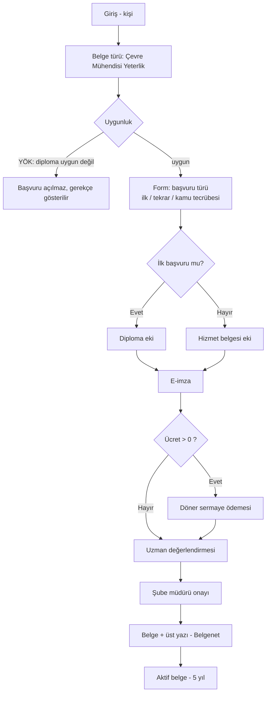
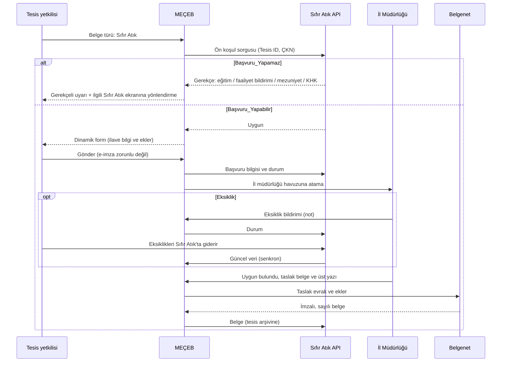

# Aşama 3 — İş Akışları ve Senaryolar

Her senaryo aynı kalıpla yazılmıştır: kaynaklarda **bilinen**, platformun **ortak** modüllerinden kullanılan,
belge türüne **özel** kalan ve **açık** olan. Kaynakta olmayan hiçbir adım varsayılmamıştır; bilinmeyen yerler
`?` ve açık soru numarasıyla (bkz. [acik-sorular.md](acik-sorular.md)) işaretlidir. Modül adları
[02-hedef-mimari.md](02-hedef-mimari.md) §4'teki adlardır.

## 0. Ortak omurga

Tüm senaryolar aşağıdaki omurganın bir alt kümesidir. Belge türü tanımı hangi adımların var olduğunu belirler.

```mermaid
flowchart LR
    A[Giriş ve<br/>taraf seçimi] --> B[Katalogdan<br/>belge türü]
    B --> C[Uygunluk ve<br/>mükerrer kontrol]
    C --> D[Form + ekler<br/>taslak]
    D --> E[Başvuran imzası<br/>koşullu]
    E --> F[Ödeme<br/>koşullu]
    F --> G[Birime atama]
    G --> H[Değerlendirme<br/>eksiklik döngüsü]
    H --> I[Onay hiyerarşisi]
    I --> J[Belge / üst yazı<br/>Belgenet]
    J --> K[Belge yaşam<br/>döngüsü]
```

| Adım | Ortak modül | Tanımla değişen | Kodla genişleyen |
| --- | --- | --- | --- |
| A | Kimlik, Taraflar | İzin verilen sahip türleri | — |
| B | Katalog | Kategori ağacı | — |
| C | Katalog, Entegrasyon | Uygunluk kuralı listesi, mükerrer politikası | `IEligibilityCheck` |
| D | Form, Başvuru, Dosya | Form şeması, ek listesi | `IOptionSource` |
| E | İş akışı, İmza | Adımın varlığı | — |
| F | Ödeme | Ücret kalemi, adımın varlığı | `IFeeCalculator` |
| G | İş akışı, Birim | Atama yöntemi | `IUnitResolver` |
| H–I | İş akışı | Adımlar, roller, süreler, geçişler | `IWorkflowStepHandler` |
| J | Üretim, Entegrasyon | Şablonlar, çıktı türü | `IDocumentDataContributor` |
| K | Belge | Süre, yenileme penceresi, izinli geçişler | — |

---

## 1. Pilot — Çevre Yetkilendirme Şubesi (B05–B07)

Araç Takip Servis Sağlayıcılarının Yeterlik Belgesi · Toprak Kirliliği Kontrolü Yeterlilik Belgesi · Deniz Yeterlilik Belgesi

**İşletim modu:** Yerel. Kapsam dokümanı: "Müstakil bir alt sistemi bulunmadığından tüm başvuru, onay ve belge
üretim süreçleri doğrudan [MEÇEB] bünyesinde sıfırdan geliştirilecektir."

**Bilinen:** belge sahibi grubu Tesis; giriş Tesis–Bakanlık; ödeme var; çıktı üst yazı; süre 5 / 5 / 4 yıl.
**Bilinmeyen:** başvuran e-imzası ve dağıtım süreci ("Soralım"), form alanları, ekler, ücretler.

| # | Adım | Aktör | Modül | Durum |
| --- | --- | --- | --- | --- |
| 1 | UÇBS ile giriş; tesis adına işlem bağlamı | Tesis yetkilisi | Kimlik, Taraflar | Bilinen |
| 2 | Katalogdan belge türü (kategori: Çevre Yetkilendirme → üç türden biri) | Tesis yetkilisi | Katalog | Bilinen |
| 3 | Uygunluk: aynı türde aktif belge veya açık başvuru var mı | Sistem | Katalog | Önerilen ortak kural; ek kural var mı ? (AS-09) |
| 4 | Form ve ekler; taslak | Tesis yetkilisi | Form, Dosya | **Alanlar bilinmiyor** (AS-09) |
| 5 | Başvuran e-imzası | Tesis yetkilisi | İmza | **?** (AS-07) |
| 6 | Döner sermaye ödemesi | Tesis yetkilisi | Ödeme | Var; kalem ve tutar ? (AS-11) |
| 7 | Birime atama | Sistem | İş akışı, Birim | **?** (AS-08) |
| 8 | Değerlendirme; eksiklik bildirimi / tamamlama | Uzman ↔ tesis | İş akışı | Ortak; tur sayısı/süre ? (AS-33) |
| 9 | Onay | **?** | İş akışı | **?** (AS-08) |
| 10 | Üst yazı üretimi, Belgenet imza ve sayı | Sistem, imza yetkilileri | Üretim, Belgenet | Çıktı "üst yazı"; ayrı belge var mı ? (AS-10) |
| 11 | Belge kaydı: aktif, geçerlilik 5/5/4 yıl; MEÇEB'de arşiv | Sistem | Belge, Dosya | Bilinen (alt uygulama yok → kalıcı arşiv MEÇEB) |
| 12 | Süre takibi, yenileme, askı, iptal | Sistem, personel | Belge | Koşullar ? (AS-13) |

**Belgeye özel olan:** üç form şeması, üç şablon, ücret kalemleri, süre değerleri. **Kod gerektiren:** yok
(öngörülen); üç tür aynı iş akışı tanımını paylaşabilir. Bu, pilotun platformu "tanımla yeni tür ekleme" açısından
sınamasını sağlar: ilk tür ile altyapı kurulur, ikinci ve üçüncü tür **yalnızca yönetim ekranından** eklenir.

**Pilotun sınamadığı yetenekler:** alt uygulama entegrasyonu (hibrit/izleme), dış ön koşul sorguları (YÖK/SGK),
paralel değerlendirme, kişi başvurusu. Bunlar sonraki senaryolarla devreye girer.

---

## 2. E-Yeterlik — Çevre Mühendisi Yeterlik Belgesi (B01)

**İşletim modu:** Yerel ("süreç doğrudan ve bütünüyle [MEÇEB] bünyesine alınacaktır").

**Bilinen:** kişi başvurusu; e-imza var; şube müdürü onayı; çıktı üst yazı + belge; 5 yıl. İlk kez başvuran çevre
mühendisi diploma yükler ve **ücretsiz** başvurur, diploma YÖK ile kontrol edilir; ikinci başvuru veya kamu/bakanlık
tecrübesiyle gelenlerden hizmet belgesi ve döner sermaye ödemesi istenir; mevcut belge geçerliliği kontrol edilir.

| Ortak modülden | Belgeye özel (tanım) | Belgeye özel (kod) |
| --- | --- | --- |
| Kimlik, Katalog, Form, Dosya, İmza, Ödeme, İş akışı, Üretim, Belge | Form şeması (`requiredWhen` ile koşullu ekler), iş akışı, şablonlar, 5 yıl | `IEligibilityCheck`: YÖK diploma · `IFeeCalculator`: "ilk başvuru ücretsiz" |

**Açık:** personel tecrübe yılı, koordinatörlük, SGK döküm kontrolleri "analiz aşamasında netleştirilecek";
danışman firma / Çevre Yönetim Birimi belgeleri ayrı türlerdir (zorunlu personel ekleme ve personelin aktif yeterlik
belgesi kontrolü → form `table` alanı + `IEligibilityCheck`); YÖK erişilemezse davranış (`Block`/`Defer`) (AS-31).

---

## 3. E-İzin — İzin ve Lisans Belgesi (B02)

**İşletim modu:** Hibrit. Kapsam dokümanı: "Ek-1 ve Ek-2 sınıfı tesisler için döner sermaye ödeme, e-imza ve durum
takibi [MEÇEB]'e entegre edilecektir"; kapsamda Geçici Faaliyet Belgesi (GFB), izin ve lisans süreçleri anılıyor.

**Bilinen:** ödeme var; e-imza var; onay Bakanlık – Daire Başkanı; çıktı üst yazı + belge; 5 yıl.

| # | Adım | Nerede | Modül |
| --- | --- | --- | --- |
| 1 | Giriş, tesis bağlamı, belge türü seçimi | MEÇEB | Kimlik, Katalog |
| 2 | Teknik başvuru formu | **E-İzin** ? | Entegrasyon (`ISubApplicationGateway`) |
| 3 | Ödeme | MEÇEB | Ödeme |
| 4 | Başvuran e-imzası | MEÇEB | İmza |
| 5 | Teknik değerlendirme | **E-İzin** ? | Entegrasyon (durum bildirimi) |
| 6 | Daire başkanı onayı, belge üretimi | ? | İş akışı / Belgenet |
| 7 | Durum takibi | MEÇEB | Başvuru (dışa görünen durum) |

**Açık:** sınırın tam yeri (hangi adım hangi sistemde); belge sahibinin tesis mi kişi mi olduğu (Ç-4, AS-24);
belgenin kalıcı kaydının ve yaşam döngüsünün (yenileme, iptal) hangi sistemde tutulacağı (AS-01, AS-04); E-İzin
servislerinin sözleşmesi (AS-42). **Belgeye özel kod:** E-İzin adapter'ı.

---

## 4. AATBEL — Atıksu Arıtma Tesisi Personel Belgelendirme (B03)

**Bilinen:** kişi; ödeme yok; e-imza yok; onay Bakanlık – Şube Müdürü; **"çıktı yok – olumlu/olumsuz durumu"**;
1 yıl. Adayların eğitim uygunluğu Eğitim ve Yayın Dairesi Başkanlığı servisinden otomatik sorgulanır.

| # | Adım | Modül | Not |
| --- | --- | --- | --- |
| 1 | Giriş (kişi), belge türü | Kimlik, Katalog | — |
| 2 | Uygunluk: eğitim teyidi | Entegrasyon | `IEligibilityCheck`: eğitim servisi |
| 3 | Form | Form | Alanlar ? (AS-20) |
| 4 | Değerlendirme, şube müdürü onayı | İş akışı | — |
| 5 | Sonuç: olumlu / olumsuz | Belge | **Dosya üretilmez**; `Document` kaydı durum + 1 yıl geçerlilikle oluşur |

Bu senaryo iki tasarım kararını doğrular: ödeme ve imza adımları olmayan bir akış tanımlanabilir; belge üretimi
"dosya" zorunlu olmadan çalışır. **Açık:** dosya yoksa 1 yıl süren şeyin ne olduğu ve doğrulamanın nasıl
yapılacağı (AS-25); işletim modu dokümanda belirtilmemiş (AS-01).

---

## 5. Sıfır Atık — Temel Seviye Sıfır Atık Belgesi (B08)

**İşletim modu:** Hibrit, çift yönlü. Kapsam dokümanında en ayrıntılı tarif edilen süreç.

| Ortak modülden | Belgeye özel (tanım) | Belgeye özel (kod) |
| --- | --- | --- |
| Kimlik, Katalog, Form, İş akışı, Birim, Üretim, Belge, Bildirim | Form (faaliyet üst bilgileri + ilave ekler), taşra akışı (Uzman → Şube Müdürü → İl Müdürü), şablon, 5 yıl, yenileme penceresi 180 gün | Sıfır Atık adapter'ı: ön koşul sorgusu, durum bildirimi, veri senkronu, belge aktarımı; `IUnitResolver`: tesisin ilindeki il müdürlüğü |

Dokümandaki hata durumları uygunluk kontrolünün dönüş kodlarına eşlenir: tesis bulunamadı, ÇKN uyuşmazlığı, zorunlu
eğitim eksik, faaliyet bildirimi eksik, servis erişilemez ("süreç güvenli biçimde askıya alınır" → `Block`).

**Yaşam döngüsü:** aktif belgede "Yenile" (geçerlilik 180 günün altına düşünce), "Askıya Al", "İptal Et"; iptal
gerekçesi girilince iptal üst yazısı üretilip Belgenet'e gider; Sıfır Atık'taki denetim sonucu durum değişikliği
MEÇEB'e servisle gelir.

**Açık:** MEÇEB'de toplanacak "ilave ek belgeler" (AS-32); iptal sonrası uyarı metni (AS-32); e-imza çelişkisi
(Ç-3); uygunsuzlukta yönlendirme çelişkisi (Ç-6); YÖK/SGK sorgusunu MEÇEB'in mi Sıfır Atık API'sinin mi yaptığı
(AS-31); onayın MEÇEB'de mi Belgenet'te mi verildiği (AS-36).

---

## 6. ÇED — ÇED Olumlu Belgesi (B15)

**İşletim modu:** İzleme (değerlendirme için) + Yerel (kapsam dışı yazısı için).

**Bilinen:** firma; çıktı ÇED Olumlu Kararı + üst yazı + belge; süresiz. Kapsam dokümanı: değerlendirme sürecinin
içine girilmeyecek, aşamalar API ile MEÇEB'e raporlanacak; **kapsam dışı** başvuru ve sonuç yazısı doğrudan MEÇEB'de
yürütülecek; EK-1/EK-2 için sıralı veya paralel **çoklu imza** ekranı geliştirilecek; dekont yükleme kaldırılıp
döner sermaye entegrasyonuyla çevrim içi ödeme yapılacak.

| Alt senaryo | Akış | Modül |
| --- | --- | --- |
| **6a. ÇED değerlendirme (izleme)** | Başvuru ÇED Bilgi Sistemi'nde; aşama değişiklikleri entegrasyon yüzeyinden gelir; başvuran MEÇEB'de durum izler; karar çıkınca belge kaydı (süresiz) oluşur | Entegrasyon, Başvuru (dışa görünen durum), Belge |
| **6b. Kapsam dışı yazısı (yerel)** | Form → (ödeme ?) → değerlendirme → onay → üst yazı (Belgenet) | Omurganın tamamı |
| **6c. Çoklu imza** | Bir adımda birden fazla imzacı; sıralı veya paralel; hepsi imzalamadan belge düzenlenmez | İş akışı: paralel görev grubu + `CompletionRule = All`; sıralı için ardışık adımlar |

Bu senaryo iş akışı modelindeki **paralel değerlendirme** yeteneğinin gerekçesidir.

**Açık:** Excel'de ödeme, e-imza, dağıtım boş (AS-19); 18. satırın ikinci bir belge olup olmadığı (AS-19); ÇED
olumlu belgesinin kaydının hangi sistemde esas olduğu (AS-01); çoklu imzanın Belgenet'te mi MEÇEB'de mi atıldığı
(AS-36, AS-38).

---

## 7. Güvenlik Bilgi Formu (B12, B16)

**Bilinen:** Excel'de iki sahip grubunda (Tesis ve Firma); giriş Tesis–Firma–Bakanlık; ödeme yok; e-imza yok;
dağıtım "Bakanlık (veri girişi gözlem)"; **çıktı yok**; süresiz; talep edilen belge "Güvenlik Bilgi Formu dosyası";
uygulama servis "kayıtların aktarımı". Her iki satırda **"Yeni analiz yapılacak"** notu var; kapsam dokümanı
"yeni dönem analizleri kapsamında… entegrasyon takvimine bağlanacaktır" diyor.

Kaynakların izin verdiği kadarıyla akış, onay değil **bildirim/tescil** niteliğindedir:

| # | Adım | Modül |
| --- | --- | --- |
| 1 | Giriş (firma veya tesis adına), tür seçimi | Kimlik, Taraflar, Katalog |
| 2 | GBF dosyasının yüklenmesi (+ form ?) | Form, Dosya |
| 3 | Bakanlık gözlemi (değerlendirme/onay var mı ?) | İş akışı (tek `Review` adımı veya doğrudan tamamlanma) |
| 4 | Kayıt; çıktı yok; süresiz | Belge |

Platform açısından sınadığı şey: **aynı belge türünün birden fazla sahip türüne** açılabilmesi (`HolderKinds`) ve
onaysız, çıktısız, süresiz bir akışın tanımlanabilmesi.

**Açık:** süreç yeniden analiz edilecek (AS-26); bu nedenle bu senaryo geliştirme planında son sıradadır ve
buradaki akış taslaktan ibarettir.

---

## 8. Atık Yönetim Uygulaması — Firma ve Araç Lisans Belgesi (B09)

**Bilinen:** Excel'de yalnızca: sahip grubu Tesis; giriş Tesis–Bakanlık; alt uygulama var; çıktı "Firma ve Araç
Lisans Belgesi". Ödeme, e-imza, dağıtım ve süre **boş**. Kapsam dokümanı: "tehlikeli atık taşıyıcı firma lisansı ve
MOYDEN araç bazlı taşıma kayıtları sisteme dahil edilecektir."

Kaynaklardan çıkarılabilen tek yapısal özellik, belgenin **firma + araç listesi** içermesidir:

| Gereksinim | Karşılığı |
| --- | --- |
| Bir başvuruda birden fazla araç | Form `table` alanı (plaka, tip…); alanlar ? |
| Araç verisinin dış kaynaktan gelmesi (MOYDEN) | `IOptionSource` / `IEligibilityCheck` adapter'ı ? |
| Lisans kapsamının sonradan değişmesi (araç ekleme/çıkarma) | "Güncelleme" başvuru türü → yeni `DocumentVersion` |
| Firma lisansı ile araç lisansının ayrı belgeler olup olmadığı | **?** — tek belge + liste mi, ana belge + araç başına alt belge mi |

**Açık:** neredeyse tüm süreç (AS-15); kapsamda olup olmadığı (AS-06, Ç-8); işletim modu (AS-01). Akış diyagramı
çizilmemiştir çünkü çizilecek adımlar kaynaklarda yoktur.

---

## 9. Diğer belge türleri (özet)

| Belge | Bilinen özellik | Platformdan beklenen | Açık |
| --- | --- | --- | --- |
| Sanayide Yeşil Dönüşüm (B04, B13) | Ödeme var; e-imza yok; çıktı üst yazı; 5 yıl; tesis başvurusunda **A kategori → Bakanlık Şube Müdürü, diğerleri → Taşra Şube Müdürü**; MEÇEB yalnızca "başvuru karşılama ve ön inceleme" | Koşullu yönlendirme: `IUnitResolver` veya geçiş koşulu (`category == "A"`) | "A kategori"nin nereden geldiği; şahıs ve tesis başvurusunun farkı |
| İthalat-İhracat (B10–B11) | Hibrit: MEÇEB'de başlar → İthalat uygulamasına yönlendirme → teknik form orada → MEÇEB'e dönüş → ödeme + e-imza → inceleme İthalat'ta; kural: bir tesis aynı atık kodu için aynı anda birden fazla aktif kayıt belgesine sahip olamaz; süre 1 yıl, süre sonu elle değiştiriliyor | Devir kodu ile yönlendirme; mükerrer kuralı `IEligibilityCheck`; yetkiyle süre düzeltme (gerekçeli, iz kayıtlı) | AS-16, AS-17 |
| AAT Belgesi (B14) | Ödeme yok; çıktı AAT Kimlik Belgesi; süresiz | Süresiz belge; kimlik belgesi şablonu | AS-18 |

---

## 10. Senaryoların platform yeteneklerine eşlemesi

Hangi yeteneğin hangi senaryoyla ilk kez gerektiğini gösterir; geliştirme sırasının dayanağıdır
([05-gelistirme-plani.md](05-gelistirme-plani.md)).

| Yetenek | Pilot | E-Yeterlik | AATBEL | Sıfır Atık | E-İzin | ÇED | İthalat | SYD | GBF | Araç Lisansı |
| --- | --- | --- | --- | --- | --- | --- | --- | --- | --- | --- |
| Dinamik form + ekler | ● | ● | ● | ● | ○ | ● (6b) | ○ | ● | ● | ● |
| Sıralı onay akışı | ● | ● | ● | ● | ? | ● | ○ | ● | ? | ? |
| Eksiklik döngüsü | ● | ● | ● | ● | ○ | ● | ○ | ● | ? | ? |
| Ödeme | ● | ● koşullu | — | — | ● | ? | ● | ● | — | ? |
| Başvuran e-imzası | ? | ● | — | ? | ● | ? | ● | — | — | ? |
| Belgenet (üst yazı / belge) | ● | ● | — | ● | ? | ● | ● | ● | — | ? |
| Süreli belge + yenileme | ● | ● | ● | ● | ● | — | ● | ● | — | ? |
| Tesis adına başvuru | ● | — | — | ● | ● | — | ● | ● | ● | ● |
| Kişi başvurusu | — | ● | ● | — | ? | — | — | ● | — | — |
| Dış ön koşul sorgusu | — | ● | ● | ● | ? | — | ● | ? | — | ? |
| Merkez/taşra yönlendirme | ? | — | — | ● | ? | ? | ? | ● | — | ? |
| Hibrit (alt uygulamaya yönlendirme) | — | — | ? | ● | ● | — | ● | ● | ? | ? |
| İzleme (dış durum bildirimi) | — | — | — | ● | ● | ● | ● | — | ? | ? |
| Paralel / çoklu imza | — | — | — | — | — | ● | — | — | — | — |
| Çıktısız sonuç | — | — | ● | — | — | — | — | — | ● | — |

● gerekli · ○ alt uygulamada · — yok · ? kaynakta belirsiz
