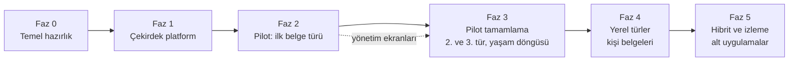
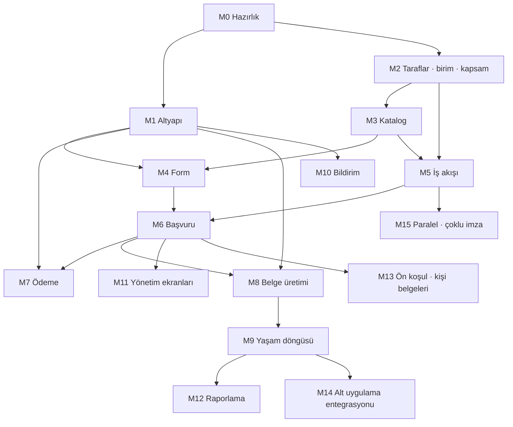

# Aşama 5 — Geliştirme Planı

Plan, [02-hedef-mimari.md](02-hedef-mimari.md) içindeki modülleri sıraya dizer. Strateji: **önce küçük ama gerçek
bir pilot belge türü uçtan uca çalışır, sonra diğer türler parametrik olarak eklenir.** Pilot: Çevre Yetkilendirme
Şubesi belgeleri (kullanıcı kararı).

Süre ve kişi-gün tahmini verilmemiştir: ekip büyüklüğü bilinmiyor ve pilotun form/akış içeriği ile üç kritik
entegrasyonun (UÇBS veri servisleri, Belgenet, Döner Sermaye) sözleşmeleri henüz açık. Tahmin, Faz 0 sonunda bu
bilgilerle yapılmalıdır.

## 1. Ön koşullar

Kod yazmadan önce:

| # | Ön koşul | Kim |
| --- | --- | --- |
| Ö-1 | Kritik mimari kararların onayı (K-1 … K-14, hedef mimari §16) | Proje yönetimi, mimari |
| Ö-2 | Git'teki gizli anahtarların değiştirilmesi ve dosyanın depodan çıkarılması (F-1) | BT, ekip — **bekletilmemeli** |
| Ö-3 | Pilot için engelleyici soruların yanıtı: AS-07 … AS-14 | Çevre Yetkilendirme Şubesi |
| Ö-4 | Entegrasyon sözleşmeleri: AS-30 (UÇBS), AS-35/36 (Belgenet), AS-37 (Döner Sermaye), AS-41 (depo, antivirüs) | İlgili ekipler |
| Ö-5 | Framework ekibinden paket desteği teyidi: AS-47 | Framework ekibi |

Ö-3 ve Ö-4 beklenirken Faz 0 ve Faz 1 başlayabilir: bu fazlar belge içeriğinden bağımsızdır ve dış sistemler **sahte
adapter**'larla temsil edilir.

## 2. Fazlar

| Faz | Hedef | Çıkış ölçütü |
| --- | --- | --- |
| **0 — Temel hazırlık** | Şablonu MEÇEB projesine çevirmek; güvenlik açıklarını kapatmak; eksik altyapıyı bağlamak | Yeniden adlandırılmış proje derleniyor, testler geçiyor; arka plan işi ve dosya saklama çalışıyor |
| **1 — Çekirdek platform** | Belge içeriğinden bağımsız motorlar: taraflar, birim/kapsam, katalog, form, iş akışı, başvuru | Seed ile tanımlanmış örnek bir belge türü için başvuru → onay akışı API testleriyle uçtan uca geçiyor |
| **2 — Pilot: ilk tür** | Çevre Yetkilendirme'nin bir belgesi gerçek kullanıcılarla, gerçek entegrasyonlarla | Bir başvuru UÇBS girişinden Belgenet'ten dönen üst yazıya kadar test ortamında tamamlanıyor |
| **3 — Pilot tamamlama** | Diğer iki türün **yalnızca yönetim ekranından** eklenmesi; yaşam döngüsü; bildirim; raporlar | İkinci ve üçüncü tür için backend'e kod eklenmedi; yenileme/askı/iptal çalışıyor |
| **4 — Yerel türler** | Kişi belgeleri (Çevre Mühendisi Yeterlik), AATBEL, ÇED kapsam dışı yazısı | Dış ön koşul sorgusu, koşullu ücret, çıktısız sonuç çalışıyor |
| **5 — Hibrit ve izleme** | Sıfır Atık, E-İzin, İthalat, SYD, ÇED izleme; paralel imza | Alt uygulama ile çift yönlü akış; devir kodu ile yönlendirme |

GBF ve Firma Araç Lisansı, analizleri tamamlanınca (AS-26, AS-15) uygun faza yerleştirilir.

## 3. Modüller

Öncelik: **P0** pilot için zorunlu · **P1** pilot tamamlama · **P2** sonraki türler.

### M0 — Proje hazırlığı ve framework iyileştirmeleri (Faz 0 · P0)

| | |
| --- | --- |
| **Bağımlılık** | Ö-1, Ö-2 |
| **Teknik gereksinim** | `rename.ps1` ile yeniden adlandırma (K-14); gizli anahtarların taşınması (İ-1); rol/yetki yükseltme açığının kapatılması (İ-2); `Admin` rolünün `IsDefault` olmaktan çıkarılması (İ-3); hata zarfı ve HTTP kodları (İ-9, K-12); rate limiting, HSTS, sağlık uç noktası (İ-10); kiracılık kararı (K-8); README'nin kodla uyumlu hale getirilmesi ve şablon kalıntılarının temizliği (İ-13); proxy'lerin yeniden üretilmesi (İ-14) |
| **Test** | Mevcut 44 test geçer; kendi sahip olmadığı yetkiyi role ekleme denemesi reddedilir; beklenmeyen hata 500 ve tutarlı gövde döner; hız sınırı aşılınca 429 |
| **Kabul** | `dotnet test` ve `ng build` temiz; depoda gizli anahtar yok (tarama aracıyla doğrulanır); F-1…F-3 kapalı |

### M1 — Altyapı servisleri (Faz 0 · P0)

| | |
| --- | --- |
| **Bağımlılık** | M0; AS-41, AS-47 |
| **Teknik gereksinim** | Arka plan işleri (`CSB.HangFire`, PostgreSQL depolama, yetkili pano) (K-13); dosya modülü: `StoredFile`, `CSB.BlobStoring` + nesne deposu sağlayıcısı, yükleme/indirme controller'ı, içerik imzası kontrolü, karantina → tarama → temiz akışı, `IMalwareScanner` portu + sahte adapter; outbox + `IntegrationLog` + yeniden deneme işi; korelasyon kimliği ve log maskeleme |
| **Test** | İzin verilmeyen uzantı / içerik reddedilir; boyut sınırı; taranmamış dosya indirilemez; outbox mesajı transaction geri alınınca oluşmaz; aynı idempotency anahtarı iki kez işlenmez; başarısız mesaj yeniden denenir ve sonunda "başarısız" kuyruğuna düşer |
| **Kabul** | Dosya yüklenir, taranır, yalnızca yetkili kullanıcı indirir; iş panosunda tekrarlı işler görünür |

### M2 — Taraflar, birim ve veri kapsamı (Faz 1 · P0)

| | |
| --- | --- |
| **Bağımlılık** | M0; AS-30 |
| **Teknik gereksinim** | `Party`, `PartyRepresentative`; `UcbsLoginContributor<User>` ile UÇBS'den taraf/temsil eşitleme; "işlem yapılan taraf" seçimi ve sunucu doğrulaması; `OrganizationUnit` için AppService + ekran, kullanıcı–birim ataması, merkez/taşra ve il uzantı alanları; `IDataScopeService` (liste daraltma + tekil kontrol); `RoleDocumentTypeScope`; kapsam kullanımını zorlayan mimari test; entity history'nin yetki entity'leri için açılması (İ-12); TCKN şifreleme + hash kolonu |
| **Test** | Kullanıcı yalnızca temsil ettiği tarafın kayıtlarını listeler; başka tarafın kaydına kimlikle erişim **404**; alt birimin kaydı üst birim personeline görünür, kardeş birime görünmez; süresi dolmuş temsil ilişkisi erişim vermez; UÇBS kaynaklı temsil kaydı elle değiştirilemez |
| **Kabul** | İki farklı tesis yetkilisi ve iki farklı birim personeliyle çapraz erişim denemelerinin tamamı reddedilir |

### M3 — Katalog (Faz 1 · P0)

| | |
| --- | --- |
| **Bağımlılık** | M2 |
| **Teknik gereksinim** | `DocumentCategory`, `DocumentType`, `DocumentTypeVersion`; sürüm durumları (taslak / yayında / kullanımdan kalktı); yayın doğrulaması; uygunluk kontrolü altyapısı (`IEligibilityCheck` kayıt defteri) + iki genel kontrol (açık başvuru yok, aktif belge yok); portal kataloğu (seçili tarafa göre süzme) |
| **Test** | Yayınlanmış sürüm değiştirilemez; eksik parçalı sürüm yayınlanamaz; sahip türü uymayan tür için başvuru başlatılamaz; pasif tür katalogda görünmez ama mevcut başvuruları etkilemez |
| **Kabul** | Yönetici bir türü tanımlar, yayınlar; portalda uygun tarafa görünür |

### M4 — Form (Faz 1 · P0)

| | |
| --- | --- |
| **Bağımlılık** | M1 (dosya), M3 |
| **Teknik gereksinim** | `FormDefinition` + şema sürümü; `FormValidator` (Core, saf C#); koşul değerlendirici (kapalı operatör kümesi); seçenek kaynakları (statik, kod listesi); Angular renderer (`@core`): alan kayıt defteri, koşullu görünürlük, tablo alanı, dosya alanı; salt-okunur form görünümü. **Form tasarım ekranı Faz 3'te**; Faz 1–2'de şema JSON olarak yönetici ekranından düzenlenir |
| **Test** | Her alan tipi ve kural için geçerli/geçersiz örnek; `visibleWhen` ile gizlenen zorunlu alan hata üretmez; şemada olmayan alan reddedilir; tablo alanında satır sınırları; frontend ve backend aynı örnek kümesinde aynı sonucu verir (ortak test verisi) |
| **Kabul** | Şema değiştirilerek, kod değişmeden yeni alanlı bir form doldurulup doğrulanır |

### M5 — İş akışı motoru (Faz 1 · P0)

| | |
| --- | --- |
| **Bağımlılık** | M2, M3 |
| **Teknik gereksinim** | `WorkflowDefinition/Step/Transition`, `WorkflowInstance/Task`; `WorkflowEngine.ExecuteAsync`; atama yöntemleri (havuz, elle, önceki adımı yapan); `IUnitResolver` kayıt defteri + "belgeyi veren birim"; eşzamanlılık koruması; tanım doğrulayıcı; SLA işi; iş listesi API'si. **Paralel grup Faz 5'te**; veri modeli baştan destekler |
| **Test** | Tanımsız geçiş reddedilir; yetkisiz rol/birim reddedilir; zorunlu açıklama/dosya; aynı göreve eşzamanlı iki işlemden biri reddedilir; yeni tanım sürümü aktif örneği etkilemez; SLA aşımında bildirim olayı; eksiklik turu sınırı |
| **Kabul** | Seed tanımıyla başvuru → inceleme → eksiklik → tamamlama → onay akışı testle geçer |

### M6 — Başvuru (Faz 1 · P0)

| | |
| --- | --- |
| **Bağımlılık** | M3, M4, M5 |
| **Teknik gereksinim** | `Application`, ekler, `DeficiencyNotice`, `ApplicationHistory` (yalnızca ekleme + hash zinciri); taslak / gönder / geri çek; başvuru numarası; dışa görünen durum; portal: sihirbaz, başvurularım, başvuru detay, eksiklik tamamlama; personel: iş listesi, değerlendirme ekranı |
| **Test** | Geçersiz form gönderilemez; taranmamış ek ile gönderilemez; mükerrer başvuru engellenir; geçmiş satırı güncellenemez/silinemez; eksiklik süresi dolunca otomatik iptal; başvuran kurum içi adım ve notları göremez |
| **Kabul** | Başvuran ve personel ekranlarından uçtan uca akış (ödeme ve belge üretimi hariç) |

### M7 — Ödeme (Faz 2 · P0)

| | |
| --- | --- |
| **Bağımlılık** | M5, M1 (outbox); AS-11, AS-37 |
| **Teknik gereksinim** | `FeeItem`, `DocumentTypeFee`, `Payment`; `IFeeCalculator` (sabit tarife); `IPaymentGateway` portu + sahte adapter + Döner Sermaye adapter'ı; geri çağrı ucu (idempotent); mutabakat işi; iş akışı `Payment` adımı; tarife ekranı |
| **Test** | Ödenmeden inceleme adımına geçilemez; aynı geri çağrı iki kez gelince tek ödeme; başarısız ödeme yeniden denenebilir; tutar 0 ise adım atlanır; geri çağrı kaybolunca mutabakat yakalar |
| **Kabul** | Test ortamında gerçek döner sermaye servisiyle ödeme tamamlanır |

### M8 — Şablon ve belge üretimi (Faz 2 · P0)

| | |
| --- | --- |
| **Bağımlılık** | M1, M6; AS-10, AS-35, AS-36; K-6, K-7 |
| **Teknik gereksinim** | `DocumentTemplate` (sürümlü), alan eşleme, üretim (taslak PDF), `IOfficialDocumentGateway` portu + sahte adapter + Belgenet adapter'ı; `Document`, `DocumentVersion` (anlık görüntü, hash), `DocumentEvent`; iş akışı `Issue` adımı; belge detay ve indirme; şablon yönetim ekranı |
| **Test** | Üretimde kullanılan şablon sürümü ve veri anlık görüntüsü saklanır; şablon sonradan değişse de eski belge aynı kalır; dosya hash'i değişirse doğrulama başarısız; Belgenet erişilemezken adım bekler ve sonra tamamlanır; aynı başvuru için iki belge üretilmez |
| **Kabul** | Onaylanan pilot başvurusu için üst yazı Belgenet'ten sayılı ve imzalı döner, başvuran indirir |

### M9 — Belge yaşam döngüsü ve doğrulama (Faz 3 · P1)

| | |
| --- | --- |
| **Bağımlılık** | M8; AS-13, AS-39 |
| **Teknik gereksinim** | Durum makinesi + tür bazlı izinli geçişler; süre işi (yenileme penceresi, hatırlatma, süre dolumu); yenileme / güncelleme başvuru türleri ve belge zinciri; askıya alma / iptal kısa akışları ve üst yazıları; süre düzeltme (gerekçeli); anonim doğrulama sayfası (hız sınırlı); belge yönetimi ekranı |
| **Test** | İzinsiz geçiş reddedilir; yenilemede eski belge "yerine yenisi düzenlendi" olur ve zincir korunur; süresiz belge süre işine girmez; doğrulama sayfası kişisel veriyi maskeler ve geçersiz kodda tekdüze yanıt verir |
| **Kabul** | Aktif belge yenilenir, askıya alınır, askıdan çıkarılır, iptal edilir; her biri iz bırakır |

### M10 — Bildirim (Faz 3 · P1)

| | |
| --- | --- |
| **Bağımlılık** | M1; AS-40 |
| **Teknik gereksinim** | Olay → `NotificationRule` → kanal; uygulama içi (framework tabloları + mevcut SignalR hub'ı, frontend'de bildirim zili), e-posta (`CSB.MailKit`), SMS portu + adapter; `NotificationLog`; kural ekranı |
| **Test** | Kural kapalıysa gönderim yok; kanal hatasında yeniden deneme; metinlerde kimlik no bulunmaz |
| **Kabul** | İstekteki on bildirim olayı pilot belgede tetiklenir |

### M11 — Yönetim ekranları (Faz 3 · P1)

| | |
| --- | --- |
| **Bağımlılık** | M3, M4, M5 |
| **Teknik gereksinim** | Belge türü tanım ekranı (sekmeli, yayın kontrol listesi, sürüm karşılaştırma); form tasarım ekranı (bölüm/alan listesi + özellik paneli + canlı önizleme); iş akışı tasarım ekranı (adım/geçiş + otomatik çizilen önizleme); kod listeleri; entegrasyon izleme (çağrı kayıtları, başarısız mesajların yeniden denenmesi) |
| **Test** | Renderer ve koşul motoru için frontend birim testleri; tasarım ekranından üretilen şema backend doğrulayıcıdan geçer |
| **Kabul** | **Pilotun 2. ve 3. belge türü, geliştirici müdahalesi olmadan yalnızca bu ekranlardan tanımlanıp yayınlanır** |

### M12 — Raporlama ve pano (Faz 3 · P1)

| | |
| --- | --- |
| **Bağımlılık** | M6, M9, M2 |
| **Teknik gereksinim** | İstekteki 12 gösterge; kapsamla süzme; dışa aktarım (`@csb/excel-export`); gerekli indeksler |
| **Test** | Farklı kapsamdaki iki kullanıcı farklı toplam görür; toplamlar liste ekranlarıyla tutarlı |
| **Kabul** | Pano ve raporlar pilot verisiyle doğru |

### M13 — Dış ön koşul sorguları ve kişi belgeleri (Faz 4 · P2)

`IEducationVerification` (YÖK), eğitim teyidi, `ICriminalRecordCheck` portları ve adapter'ları; erişilemezlik
politikası (`Block` / `Defer`); koşullu ücret hesaplayıcı; çıktısız sonuç. Bağımlılık: AS-31. Kabul: Çevre Mühendisi
Yeterlik ve AATBEL senaryoları (03-senaryolar §2, §4) uçtan uca.

### M14 — Alt uygulama entegrasyonu: hibrit ve izleme (Faz 5 · P2)

`ISubApplicationGateway`; devir kodu ile yönlendirme (K-9); `api/integration/*` yüzeyi (uygulama bazlı kimlik);
dış durum bildirimi → dışa görünen durum; belge aktarımı. Bağımlılık: AS-01, AS-42. Sıra önerisi: Sıfır Atık
(en ayrıntılı tarif) → İthalat → E-İzin → SYD → ÇED izleme.

### M15 — Paralel değerlendirme ve çoklu imza (Faz 5 · P2)

Görev grubu + tamamlanma kuralı; başvuran e-imzası adımı (AS-38). Kabul: ÇED çoklu imza senaryosu (03 §6c).

## 4. Bağımlılık özeti

Aynı anda yürütülebilecek kollar: (M1) ile (M2 → M3); (M4) ile (M5); (M7) ile (M8); (M9), (M10), (M11), (M12).

## 5. Pilotun uçtan uca kabul senaryosu

Faz 2 sonunda test ortamında, gerçek entegrasyonlarla:

1. Tesis yetkilisi UÇBS ile giriş yapar; tesis adına işlem bağlamı doğrulanır.
2. Katalogdan pilot belge türünü seçer; uygunluk kontrolleri geçer.
3. Formu doldurur, ekleri yükler (taranır), taslak kaydeder, çıkıp geri döner ve devam eder.
4. Gönderir; döner sermaye ödemesini yapar.
5. Başvuru belgeyi veren birimin havuzuna düşer; uzman üstlenir.
6. Uzman eksiklik bildirir; başvuran bildirim alır, tamamlar.
7. Uzman uygun görüş verir; amir onaylar.
8. Üst yazı üretilir, Belgenet'te imzalanır, sayı alır; başvuran indirir.
9. Belge aktif ve süreli görünür; doğrulama kodu ile anonim sayfada doğrulanır.
10. Başka bir tesisin yetkilisi ve başka bir birimin personeli bu başvuruya **erişemez**.
11. İşlem geçmişi her adımı (kim, ne zaman, hangi gerekçeyle) gösterir.

Faz 3 kabulü: ikinci ve üçüncü belge türü **backend'e kod eklenmeden** tanımlanır; bir belge yenilenir, askıya alınır,
iptal edilir.

## 6. Test stratejisi

| Düzey | Araç | Kapsam |
| --- | --- | --- |
| Birim | xUnit + Shouldly | `FormValidator`, koşul değerlendirici, `WorkflowEngine`, ücret hesaplayıcılar, durum makinesi |
| Entegrasyon | `ProjectNameTestBase` (EF in-memory) | AppService'ler, yetki ve **kapsam** (her uç için negatif test), sürümleme |
| PostgreSQL'e özgü | Ayrı test koşusu (gerçek Postgres) | `jsonb` sorguları, eşzamanlılık, sequence — in-memory sağlayıcı bunları doğrulamaz; CI'da konteynerle koşturulmalı |
| Mimari | xUnit | Modül sınırları; kapsam servisinin kullanımı; `[CSBAuthorize]` eksik AppService |
| Sözleşme | Sahte adapter + kayıtlı yanıtlar | Her entegrasyon portu; hata ve zaman aşımı yolları |
| Frontend | Karma/Jasmine | Form renderer'ı, koşul motoru (backend ile ortak örnek kümesi) |
| Uçtan uca | Test ortamı | §5'teki kabul senaryosu |
| Güvenlik | Gözden geçirme + sızma testi | Dosya yükleme, IDOR, yetki yükseltme, anonim doğrulama; canlıya çıkış öncesi |

## 7. Riskler

| Risk | Etki | Önlem |
| --- | --- | --- |
| Pilotun form ve akış içeriği "Soralım" durumunda | Faz 2 başlayamaz | Faz 0–1 içerikten bağımsız; Ö-3 erken başlatılır |
| Belgenet / Döner Sermaye / UÇBS servis sözleşmeleri belirsiz | Faz 2 gecikir | Portlar + sahte adapter ile geliştirme sürer; sözleşmeler Faz 0'da istenir |
| MEÇEB ile Belgenet'te çift onay akışı (AS-36) | Kullanıcı yükü, tutarsızlık | Karar Faz 2 öncesi; tek doğruluk kaynağı belirlenir |
| Hibrit modda sınırın belirsizliği (AS-01) | Yeniden iş | Hibrit türler Faz 5; pilot ve Faz 4 yerel türlerle öğrenilir |
| Framework paketlerinin (Hangfire, BlobStoring) desteklenmemesi | Altyapı yeniden seçilir | AS-47 Faz 0'ın ilk işi; yedek seçenekler hedef mimaride belirtildi |
| Metadata'nın aşırı genelleşmesi | Karmaşık, test edilemez platform | Yalnızca kaynaklarda görülen değişkenlik desteklenir; gerisi genişletme noktası |
| In-memory testlerin Postgres davranışını kaçırması | Canlıda hata | Postgres'e özgü test koşusu |
| Mevcut belgelerin göçü kararı (AS-05) geç gelirse | Yenileme ve doğrulama eksik kalır | Karar Faz 3 öncesi |
